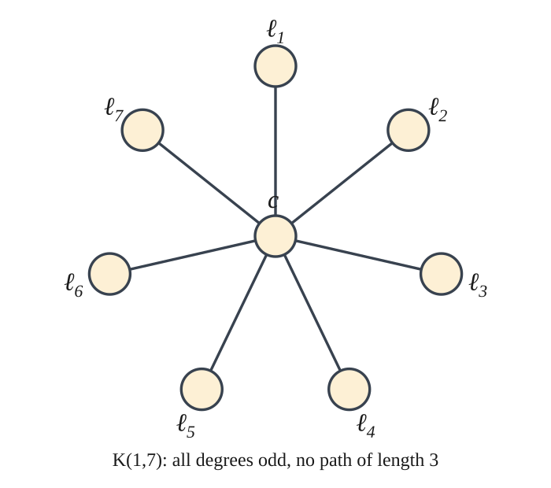
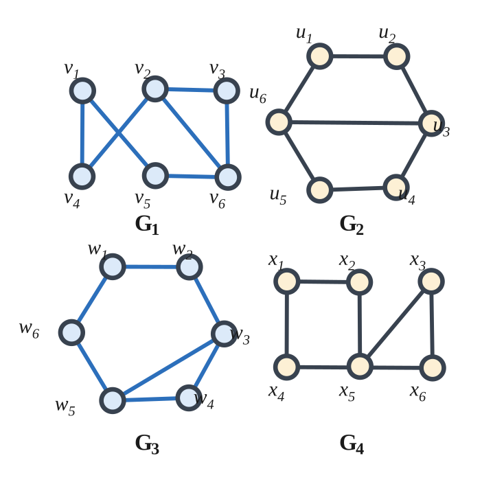
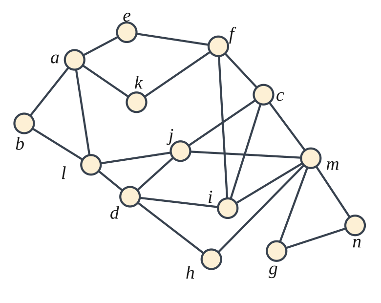
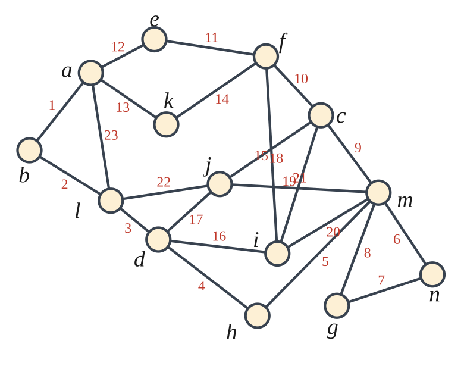
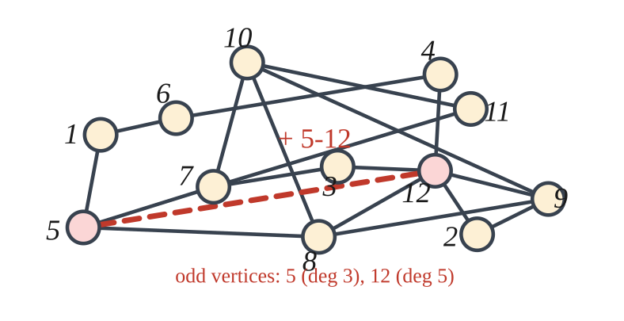
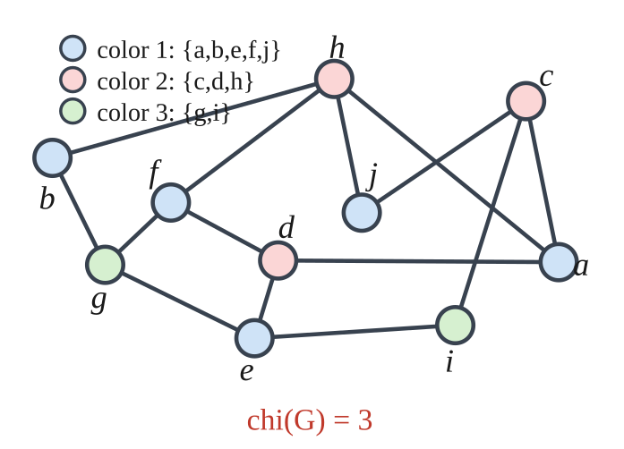
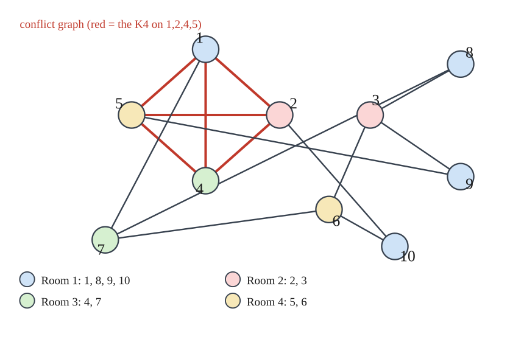
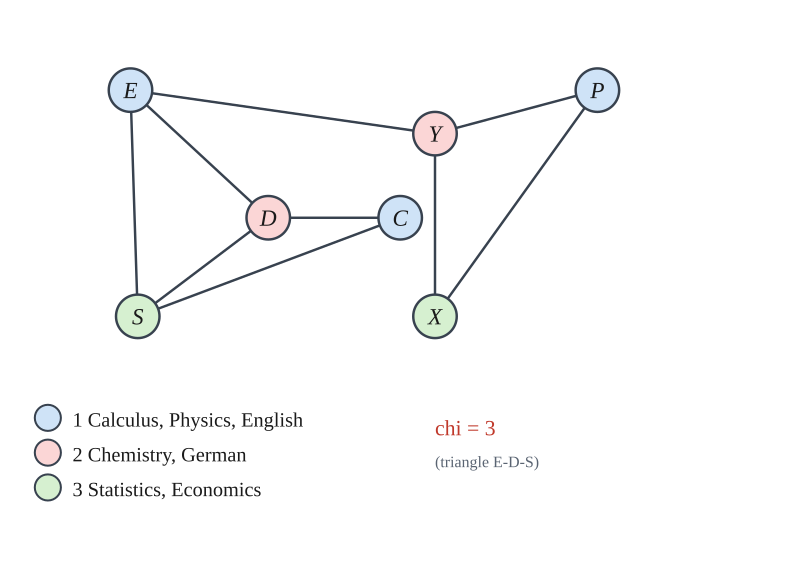

# HW3 — Chapter 5: Graph Theory (Solutions)


---

## Exercise 5.9.2

**Problem.** Draw a graph with $8$ vertices, all of odd degree, that does not contain a path of length $3$, or explain why such a graph does not exist.

**Solution.** Such a graph does exist. The simplest example is the star $K_{1,7}$: one centre $c$ joined to seven leaves $\ell_1,\dots,\ell_7$, and no other edges.



- **Degrees.** $d(c)=7$ and $d(\ell_i)=1$ for all $i$. All eight degrees are odd. ✓
- **No path of length 3.** Every simple path of $K_{1,7}$ is either a single edge, or has the form $\ell_i c \ell_j$ with $i\neq j$; hence its length is at most $2$. ✓

---

## Exercise 5.9.3

**Problem.** Draw a graph with $6$ vertices having degrees $5,4,4,2,1,1$, or explain why such a graph does not exist.

**Solution.** Such a graph does **not** exist. If $v_1,\dots,v_6$ had these degrees, then by the handshake lemma

$$
\sum_{i=1}^{6} d(v_i)=5+4+4+2+1+1=17=2|E|
$$

would be even, which is false ($17$ is odd). Equivalently, the sequence contains an odd number ($3$) of odd entries.

Hence no graph on $6$ vertices has degree sequence $(5,4,4,2,1,1)$. $\blacksquare$

---

## Exercise 5.9.4

**Problem.** Curling: $14$ teams in two pools of $7$; each team plays $7$ games, $5$ against teams of its own pool and $2$ against teams of the other pool. Model the situation with a graph and either show the plan is impossible or devise a schedule.

**Model.** Let $G$ have one vertex per team, and one edge per game. The plan asks for a graph on $14$ vertices in which every vertex has degree $7$, and such that in addition each team has exactly $5$ opponents inside its own pool.

**The plan is impossible.**

Let $P$ be one pool (a set of $7$ teams) and let $H=G[P]$ be the subgraph induced by $P$. Inside the pool, every team has exactly $5$ opponents, so $H$ is $5$-regular on $7$ vertices. The handshake lemma applied to $H$ gives

$$
2|E(H)|=\sum_{v\in P}d_H(v)=7\cdot 5=35,
$$

which is impossible because $2|E(H)|$ is even while $35$ is odd.

So the organizers must change the plan (for instance, let each team play $6$ or $8$ games, or use pools of even size).

---

## Exercise 5.9.6

**Problem.** Prove that every tree on $n$ vertices has exactly $n-1$ edges.

**Proof (induction on $n$).**

*Base case.* $n=1$: the only tree is $K_1$, which has $0=n-1$ edges.

*Inductive step.* Let $T$ be a tree on $n\ge 2$ vertices. First we show that $T$ has a **leaf** (a vertex of degree $1$). Let $P=v_1v_2\cdots v_k$ be a longest path in $T$, and suppose $d(v_1)\ge 2$. Then $v_1$ has a neighbour $u\ne v_2$. Because $P$ is longest, $u$ must lie on $P$ (otherwise $uv_1v_2\cdots v_k$ would be a longer path); say $u=v_i$ with $i\ge 3$. But then $v_1v_2\cdots v_iv_1$ is a cycle in $T$, contradicting that $T$ is acyclic. Hence $d(v_1)=1$.

Delete the leaf $v_1$ and its unique edge: the graph $T'=T-v_1$ is still connected (the only paths destroyed are those ending at $v_1$) and still acyclic, so $T'$ is a tree on $n-1$ vertices. By the induction hypothesis,

$$
|E(T')|=(n-1)-1=n-2 .
$$

Therefore

$$
|E(T)|=|E(T')|+1=(n-2)+1=n-1 . \qquad\blacksquare
$$

*Consistency check.* Since every edge is counted twice in $\sum_v d(v)$, the statement is equivalent to $\sum_{v}d(v)=2(n-1)$ for a tree on $n\ge 2$ vertices; the induction above is the rigorous proof of both forms.

---

## Exercise 5.9.7

**Problem.** Figure 5.49 contains four graphs on six vertices. Determine which (if any) pairs are isomorphic; give an isomorphism for isomorphic pairs and explain the failure for the others.

**Data read off Figure 5.49** (edges as unordered pairs of labels; each graph is drawn with the labels shown beside the vertices):

```text
G1:  v1v4, v1v5, v2v3, v2v4, v2v6, v3v6, v5v6                (7 edges)
G2:  u1u2, u2u3, u3u4, u4u5, u5u6, u6u1, u3u6                (7 edges)
G3:  w1w2, w2w3, w3w4, w4w5, w5w6, w6w1, w3w5                (7 edges)
G4:  x1x4, x4x6, x6x3, x3x5, x5x2, x2x1                      (6 edges)
```



Degree sequences:

```text
G1:  (3,3,2,2,2,2)   v2, v6 have degree 3
G2:  (3,3,2,2,2,2)   u3, u6 have degree 3
G3:  (3,3,2,2,2,2)   w3, w5 have degree 3
G4:  (2,2,2,2,2,2)   G4 is a 6-cycle
```

**Only $G_1$ and $G_3$ are isomorphic.** An isomorphism $G_1\to G_3$ is

$$
\varphi:\quad v_1\mapsto w_1,\quad v_2\mapsto w_3,\quad v_3\mapsto w_4,\quad v_4\mapsto w_2,\quad v_5\mapsto w_6,\quad v_6\mapsto w_5 .
$$

Indeed the seven edges of $G_1$ map to edges of $G_3$:

```text
v1v4 → w1w2 ✔   v1v5 → w1w6 ✔   v2v3 → w3w4 ✔   v2v4 → w3w2 ✔
v2v6 → w3w5 ✔   v3v6 → w4w5 ✔   v5v6 → w6w5 ✔
```

Since $\varphi$ is a bijection and (both graphs having $7$ edges) every edge of $G_3$ is hit exactly once, $\varphi$ is an isomorphism.

**Structural description.** $G_1$ and $G_3$ are the same 6-cycle with one chord joining vertices at distance $2$; equivalently a triangle with a path of length $4$ attached to two of the triangle's vertices:

- $G_1$: the 6-cycle $v_1v_4v_2v_3v_6v_5v_1$ plus the chord $v_2v_6$, which creates the triangle $v_2v_3v_6$ (here $v_2$ and $v_6$ are at distance $2$ along the cycle);
- $G_3$: cycle $w_5w_6w_1w_2w_3w_4w_5$ plus the chord $w_3w_5$, creating the triangle $w_3w_4w_5$.

**Why nobody else matches.**

- $G_2$ is a 6-cycle $u_5u_6u_1u_2u_3u_4u_5$ together with the chord $u_3u_6$, which joins two vertices at distance $3$ of the cycle. Two 4-cycles share the edge $u_3u_6$, and $G_2$ has **no triangle**. Since $G_1$ and $G_3$ both contain a triangle, $G_2\not\cong G_1,G_3$. And $G_2$ has $7$ edges while $G_4$ has $6$, so $G_2\not\cong G_4$.
- $G_4$ is just a 6-cycle: $|E(G_4)|=6\neq 7=|E(G_1)|$, so $G_4\not\cong G_1,G_2,G_3$.

Hence the only isomorphic pair is $\{G_1,G_3\}$, and $G_2$, $G_4$ are each isomorphic only to themselves.

---

## Exercise 5.9.9

**Problem.** For the graph $G$ of Figure 5.51: is it eulerian (if yes, give an eulerian circuit)? Is it hamiltonian (if yes, give a hamiltonian cycle)?



**Data read off Figure 5.51** (labels $a$–$n$; adjacency lists):

```text
a: b e k l      b: a l          c: f i j m      d: h i j l
e: a f          f: c e i k      g: m n          h: d m
i: c d f m      j: c d l m      k: a f          l: a b d j
m: c g h i j n  n: g m
```

Degrees:

```text
a4  b2  c4  d4  e2  f4  g2  h2  i4  j4  k2  l4  m6  n2      (23 edges)
```

All degrees are even and $G$ is connected (e.g. every vertex is reachable from $a$). By Euler's criterion, **$G$ is eulerian**.



*The numbers $1,\dots,23$ on the edges give the order in which the circuit traverses them.*

**An eulerian circuit** (it uses each of the $23$ edges exactly once):

```text
a → b → l → d → h → m → n → g → m → c → f → e → a → k → f → i → d
  → j → c → i → m → j → l → a
```

Edge check: $ab, bl, ld, dh, hm, mn, ng, gm, mc, cf, fe, ea, ak, kf, fi, id, dj, jc, ci, im, mj, jl, la$ — these are exactly the $23$ edges, each appearing once. ✓

**$G$ is not hamiltonian.** The vertices $g$ and $n$ both have degree $2$, with edges $gn$, $gm$, $nm$; so $\{g,m,n\}$ spans a triangle. In any hamiltonian cycle every vertex of degree $2$ must use **both** of its incident edges. Hence such a cycle would have to contain the edges $gn$ and $gm$ (from $g$) and the edges $gn$ and $nm$ (from $n$). Then $n-g-m-n$ is a closed $3$-cycle inside the hamiltonian cycle, which would therefore visit only the three vertices $g,m,n$ — impossible, since $G$ has $14$ vertices.

So $G$ has an eulerian circuit but no hamiltonian cycle.

---

## Exercise 5.9.10

**Problem.** Explain why the graph $G$ of Figure 5.52 has no eulerian circuit, but show that adding a single edge makes it eulerian.



**Data read off Figure 5.52** (vertices $1$–$12$; edges):

```text
1-5, 1-6, 2-9, 2-12, 3-7, 3-12, 4-6, 4-12, 5-7,
5-8, 7-10, 7-11, 8-9, 8-10, 8-12, 9-10, 9-12, 10-11
```

Degrees:

| vertex | 1 | 2 | 3 | 4 | 5           | 6 | 7 | 8 | 9 | 10 | 11 | 12          |
| ------ | - | - | - | - | ----------- | - | - | - | - | -- | -- | ----------- |
| degree | 2 | 2 | 2 | 2 | **3** | 2 | 4 | 4 | 4 | 4  | 2  | **5** |

**Why there is no eulerian circuit.** $G$ is connected, and its only vertices of odd degree are $5$ (degree $3$) and $12$ (degree $5$). A connected graph has an eulerian *circuit* exactly when all degrees are even (Euler's theorem); equivalently, a closed walk crossing every edge once enters and leaves each vertex equally often, so every degree must be even. Since $G$ has two odd-degree vertices, no eulerian circuit exists (there is an eulerian *trail*, from $5$ to $12$).

**Adding one edge.** Add the edge $5$–$12$. The degrees become $d(5)=4$ and $d(12)=6$, all other degrees unchanged, so every vertex now has even degree; $G+5\!-\!12$ is connected, hence eulerian. An eulerian circuit is

```text
5 → 1 → 6 → 4 → 12 → 3 → 7 → 11 → 10 → 9 → 2 → 12 → 8 → 5
  → 7 → 10 → 8 → 9 → 12 → 5
```

which uses the $18$ original edges plus the new edge $5$–$12$, i.e. all $19$ edges of $G+5\!-\!12$ exactly once. ✓

---

## Exercise 5.9.13

**Problem.** Find the chromatic number of the graph $G$ of Figure 5.53 and exhibit a coloring with $\chi(G)$ colors.



**Data read off Figure 5.53** (vertices $a$–$j$; the $14$ edges):

```text
bh, bg, ge, ei, ic, cj, jh, gf, fd, de, da, ac, fh, ah
```

Adjacency lists:

```text
a: c d h        b: g h          c: a i j        d: a e f
e: d g i        f: d g h        g: b e f        h: a b f j
i: c e          j: c h
```

**$\chi(G)=3$.**

*Lower bound.* $G$ contains the $5$-cycle

$$
a-c-i-e-d-a,
$$

and an odd cycle cannot be 2-colored (the two colors would have to alternate around it). Hence $\chi(G)\ge 3$; in particular $G$ is **not** bipartite.

*Upper bound (a proper 3-coloring).* Take the color classes

$$
\{\,a,\ b,\ e,\ f,\ j\,\},\qquad \{\,c,\ d,\ h\,\},\qquad \{\,g,\ i\,\}.
$$

Each pair inside a class is non-adjacent:

```text
{a,b,e,f,j}: ab, ae, af, aj, be, bf, bj, ef, ej, fj — none is an edge ✔
{c,d,h}    : cd, ch, dh — none is an edge ✔
{g,i}      : gi — not an edge ✔
```

and every edge of $G$ joins two different classes, e.g. $a$–$c$, $a$–$d$, $a$–$h$, $c$–$i$, $c$–$j$, $d$–$e$, $d$–$f$, $e$–$g$, $e$–$i$, $f$–$g$, $f$–$h$, $g$–$b$, $h$–$b$, $h$–$j$. ✔

Therefore $\chi(G)=3$ (color 1: $a,b,e,f,j$; color 2: $c,d,h$; color 3: $g,i$). The only obstruction to a 2-coloring is precisely the odd cycle $a\,c\,i\,e\,d\,a$.

---

## Exercise 5.9.15

**Problem.** Ten chemicals; a $1$ in position $(i,j)$ of the given matrix means chemicals $i$ and $j$ cannot share a room. Model the problem by a graph and find the minimum number of rooms.

**Model.** Let $G$ have one vertex per chemical and an edge $\{i,j\}$ whenever the entry is $1$. A valid assignment of chemicals to rooms is exactly a proper vertex coloring of $G$: chemicals in the same room must be non-adjacent. So the answer is $\chi(G)$.

From the matrix (symmetry checked):

```text
1: 2,4,5,7     2: 1,4,5,10    3: 6,8,9      4: 1,2,5
5: 1,2,4,9     6: 3,7,10      7: 1,6,8      8: 3,7
9: 3,5        10: 2,6
```



**$\chi(G)=4$, so $4$ rooms are necessary and sufficient.**

*Lower bound.* The four chemicals $1,2,4,5$ are pairwise incompatible:

$$
1\!-\!2,\; 1\!-\!4,\; 1\!-\!5,\; 2\!-\!4,\; 2\!-\!5,\; 4\!-\!5
$$

are all edges, i.e. $\{1,2,4,5\}$ induces $K_4$. Four mutually adjacent vertices need four distinct rooms, so at least $4$ rooms are required.

*Upper bound (a proper 4-coloring).*

| Room | Chemicals   | Check                                                                       |
| ---- | ----------- | --------------------------------------------------------------------------- |
| 1    | 1, 8, 9, 10 | $1\!-\!8,1\!-\!9,1\!-\!10,8\!-\!9,8\!-\!10,9\!-\!10$ are all non-edges ✔ |
| 2    | 2, 3        | $2\!-\!3$ is not an edge ✔                                               |
| 3    | 4, 7        | $4\!-\!7$ is not an edge ✔                                               |
| 4    | 5, 6        | $5\!-\!6$ is not an edge ✔                                               |

Every conflict of the matrix is separated (check: $1\!-\!2,1\!-\!4,1\!-\!5,1\!-\!7,2\!-\!4,2\!-\!5,2\!-\!10,3\!-\!6,3\!-\!8,3\!-\!9,4\!-\!5,5\!-\!9,6\!-\!7,6\!-\!10,7\!-\!8$ all join different rooms ✔).

**Answer: $4$ rooms** — e.g. $\{1,8,9,10\},\{2,3\},\{4,7\},\{5,6\}$, and $3$ rooms never suffice because of the $K_4$ on $\{1,2,4,5\}$.

---

## Exercise 5.9.16

**Problem.** Seven single-section courses (calculus $C$, physics $P$, English $E$, statistics $S$, economics $X$, chemistry $Y$, German $D$) and six students with the following course lists; each student takes at most one course per period. Find the minimum number of class periods.

| Student | Courses                                        |
| ------- | ---------------------------------------------- |
| 1       | chemistry$Y$, physics $P$, economics $X$ |
| 2       | English$E$, German $D$, statistics $S$   |
| 3       | statistics$S$, calculus $C$, German $D$  |
| 4       | chemistry$Y$, physics $P$                  |
| 5       | English$E$, chemistry $Y$                  |
| 6       | chemistry$Y$, economics $X$                |



**Model.** Build the *conflict graph* $H$: one vertex per course, and an edge between two courses that some student takes both of (such courses cannot be in the same period). Then the minimum number of periods equals $\chi(H)$.

Edges forced by the students:

```text
student 1: YP, YX, PX        student 2: ED, ES, DS      student 3: SC, SD, CD
student 4: YP  (already)     student 5: EY               student 6: YX (already)
```

So

$$
E(H)=\{\,YP,\,YX,\,PX,\,ED,\,ES,\,DS,\,SC,\,SD,\,CD,\,EY\,\}.
$$

**$\chi(H)=3$: three periods are necessary and sufficient.**

*Lower bound: 3 periods are needed.* Student 2 takes English, German and statistics, and any two of these conflict, so $\{E,D,S\}$ induces a triangle $K_3$ in $H$. A triangle needs three different periods. (Equivalently, student 3 forces the triangle $\{S,C,D\}$.) Hence $\ge 3$ periods.

*Upper bound: 3 periods suffice.* Use the coloring

| Period | Courses                                     | Check (no conflicts inside a period) |
| ------ | ------------------------------------------- | ------------------------------------ |
| 1      | Calculus$C$, Physics $P$, English $E$ | $CP, CE, PE$ are non-edges ✔      |
| 2      | Chemistry$Y$, German $D$                | $YD$ is a non-edge ✔              |
| 3      | Statistics$S$, Economics $X$            | $SX$ is a non-edge ✔              |

Check that all ten conflicts are split: $YP$ (1,2), $YX$ (2,3), $PX$ (1,3), $ED$ (1,2), $ES$ (1,3), $DS$ (2,3), $SC$ (3,1), $SD$ (3,2), $CD$ (1,2), $EY$ (1,2). ✔

**Answer: $3$ class periods**, e.g.

```text
Period 1: calculus, physics, English
Period 2: chemistry, German
Period 3: statistics, economics
```

and $2$ periods are impossible because a single student (no. 2) already needs $3$ mutually conflicting courses.
