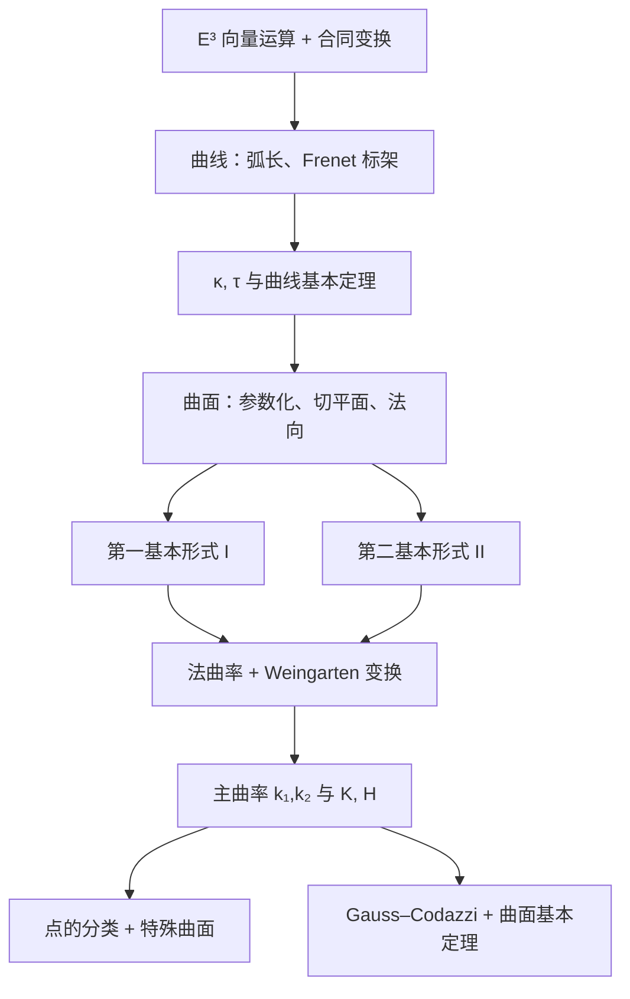

# 微分几何 · 期中一命速通

> **适用范围**：欧氏空间 → 曲线论（Frenet 标架、曲率、挠率）→ 曲面论（第一/二基本形式、法曲率、主曲率、Gauss 曲率）→ 结构方程与曲面基本定理。
>
> **怎么用**：第 0、1 章必须吃透；第 2 章先背"求 $\mathrm I,\mathrm{II},K,H$ 的五步"，再回头补概念；第 3、4 章考前直接背。
>
> **一句话主线**：**曲线看 $\kappa,\tau$；曲面看 $\mathrm I,\mathrm{II}$；两者都归结为同一个动作——参数化、求导、取内积与叉积。**

---

## 0. 先把工具箱摆好

### 0.1 三种积（一切计算的原料）

对 $\boldsymbol v=(x^1,x^2,x^3),\ \boldsymbol w=(y^1,y^2,y^3)$：

| 名称 | 公式 | 几何意义 |
|---|---|---|
| 内积 | $\langle\boldsymbol v,\boldsymbol w\rangle=x^1y^1+x^2y^2+x^3y^3$ | 长度、夹角 |
| 外积 | $\boldsymbol v\wedge\boldsymbol w=(x^2y^3-x^3y^2,\ x^3y^1-x^1y^3,\ x^1y^2-x^2y^1)$ | 平行四边形面积，方向右手定则 |
| 混合积 | $(\boldsymbol v_1,\boldsymbol v_2,\boldsymbol v_3)=\langle\boldsymbol v_1,\boldsymbol v_2\wedge\boldsymbol v_3\rangle$ | 平行六面体**有向体积** |

三条要随手能写出来的恒等式：

$$
\boldsymbol v_1\wedge(\boldsymbol v_2\wedge\boldsymbol v_3)=\langle\boldsymbol v_1,\boldsymbol v_3\rangle\boldsymbol v_2-\langle\boldsymbol v_1,\boldsymbol v_2\rangle\boldsymbol v_3
$$

$$
\langle\boldsymbol v_1\wedge\boldsymbol v_2,\boldsymbol v_3\wedge\boldsymbol v_4\rangle
=\langle\boldsymbol v_1,\boldsymbol v_3\rangle\langle\boldsymbol v_2,\boldsymbol v_4\rangle
-\langle\boldsymbol v_1,\boldsymbol v_4\rangle\langle\boldsymbol v_2,\boldsymbol v_3\rangle
$$

$$
(\boldsymbol v_1,\boldsymbol v_2,\boldsymbol v_3)=(\boldsymbol v_2,\boldsymbol v_3,\boldsymbol v_1)=(\boldsymbol v_3,\boldsymbol v_1,\boldsymbol v_2)
$$

> **考试最常用的推论**：$|\boldsymbol a\wedge\boldsymbol b|^2=|\boldsymbol a|^2|\boldsymbol b|^2-\langle\boldsymbol a,\boldsymbol b\rangle^2$，以及
> $\boldsymbol a\wedge\boldsymbol b=0\iff\boldsymbol a\parallel\boldsymbol b$。

顺带记住（第一章的向量分析）：$\operatorname{rot}\operatorname{grad}f=\nabla\wedge\nabla f=0$，$\operatorname{div}\operatorname{rot}\boldsymbol F=\langle\nabla,\nabla\wedge\boldsymbol F\rangle=0$。

### 0.2 合同变换（刚体运动）

$$
\mathcal T(X)=XT+P_0,\qquad T\in O(3),\ P_0\in E^3
$$

- $\det T=1$：**刚体运动**（保向）；
- $\det T=-1$：**反向刚体运动**（镜像）；
- $O(3)$ 中 $T^{\mathrm T}T=I_3$，所以内积、长度、夹角全都不变。

| 量 | 刚体运动 $\det T=1$ | 镜像 $\det T=-1$ |
|---|---|---|
| 弧长 $s$ | 不变 | 不变 |
| 曲率 $\kappa$ | 不变 | 不变 |
| 挠率 $\tau$ | 不变 | **变号** |
| 第一基本形式 $\mathrm I$ | 不变 | 不变 |
| 第二基本形式 $\mathrm{II}$ | 不变 | **变号** |

> 记忆：$\boldsymbol b=\boldsymbol t\wedge\boldsymbol n$ 是"叉积"，镜像后整体翻向，所以 $\tau$ 和 $\mathrm{II}$ 这类**带定向**的量变号。

### 0.3 一条万能策略

**凡是几何量，先参数化，再求导，最后取内积/叉积。**
曲线用 $t$ 或弧长 $s$；曲面用 $(u,v)$。方向导数、切向量、法向量、曲率，全部由这个动作产生。

---

## 1. 曲线论

### 1.1 曲线、正则、弧长参数

**正则曲线** $\boldsymbol r:(a,b)\to E^3$：每个分量 $C^\infty$，且

$$
\left|\frac{\mathrm d\boldsymbol r}{\mathrm dt}\right|>0 .
$$

弧长：

$$
s(t)=\int_{a}^{t}|\boldsymbol r'(u)|\,\mathrm du
\quad\Longrightarrow\quad
\left|\frac{\mathrm d\boldsymbol r}{\mathrm ds}\right|=1 .
$$

用弧长参数后，$\boldsymbol t(s)=\dfrac{\mathrm d\boldsymbol r}{\mathrm ds}$ 自动是单位切向量，所有公式都变干净。**这就是为什么理论讨论一律用 $s$。**

> **两条最基本的事实**
> 1. $|\boldsymbol\alpha(t)|\equiv$ 常数 $\iff\langle\boldsymbol\alpha,\boldsymbol\alpha'\rangle\equiv0$（对 $|\boldsymbol\alpha|^2$ 求导）。
> 2. $\boldsymbol\alpha$ 方向不变 $\iff\boldsymbol\alpha\wedge\boldsymbol\alpha'=0$。

**弧长的严格定义与"直线最短"**：对任意划分 $P$ 取折线长之和的上确界，可证

$$
L(\alpha,[a,b])=\int_a^b|\boldsymbol\alpha'(t)|\,\mathrm dt ,
$$

再由 $|\boldsymbol q-\boldsymbol p|=\left|\int_a^b\boldsymbol\gamma'(t)\mathrm dt\right|\le\int_a^b|\boldsymbol\gamma'(t)|\mathrm dt$，等号只在 $\boldsymbol\gamma'$ 与 $\boldsymbol q-\boldsymbol p$ 同向（即走直线段）时成立。

### 1.2 平面曲线：只有一个曲率

设 $\boldsymbol r(s)=(x(s),y(s))$，$\boldsymbol t=\boldsymbol r'$，把 $\boldsymbol n$ 取为 $\boldsymbol t$ **逆时针转 $90^\circ$**，则 $\{\boldsymbol t,\boldsymbol n\}$ 是右手正交标架，且

$$
\boxed{\ \dot{\boldsymbol t}=k\,\boldsymbol n,\qquad \dot{\boldsymbol n}=-k\,\boldsymbol t\ }
$$

这里的 $k$ 是**有符号曲率**：$k>0$ 表示向左弯（$\boldsymbol n$ 指向凹侧），$k<0$ 向右弯。

**理解方式**：设 $\boldsymbol t=(\cos\theta,\sin\theta)$，则

$$
k=\frac{\mathrm d\theta}{\mathrm ds},
$$

即"切线转角对弧长的变化率"。$|k|=1/R$，$R$ 是曲率半径。

**平面曲线的三种算法**

| 已知形式 | 曲率公式 |
|---|---|
| 一般参数 $\boldsymbol r(t)=(x(t),y(t))$ | $\displaystyle k=\frac{x'y''-x''y'}{\big(x'^2+y'^2\big)^{3/2}}$ |
| 显式 $y=f(x)$ | $\displaystyle k=\frac{f''}{\big(1+f'^2\big)^{3/2}}$ |
| 极坐标 $r=f(\theta)$ | $\displaystyle k=\frac{f^2+2f'^2-ff''}{\big(f^2+f'^2\big)^{3/2}}$ |

> 极坐标公式的来历：把 $\boldsymbol r(\theta)=\big(f\cos\theta,f\sin\theta\big)$ 代进第一行，算完
> $|\boldsymbol r'|^2=f^2+f'^2$，$x'y''-x''y'=f^2-ff''+2f'^2$，直接得到。

**平面曲线基本定理**：给定连续可微的 $k(s)$，存在以 $s$ 为弧长的平面曲线，且相差平面刚体运动唯一。
（对比空间曲线：需要 $\kappa$ 和 $\tau$ 两个函数。）

### 1.3 空间曲线：Frenet 标架

设 $\boldsymbol r(s)$ 以弧长 $s$ 为参数。定义

$$
\boldsymbol t=\dot{\boldsymbol r},\qquad
\kappa=|\dot{\boldsymbol t}|\ \ (\ge0),\qquad
\boldsymbol n=\frac{\dot{\boldsymbol t}}{\kappa}\ (\kappa>0),\qquad
\boldsymbol b=\boldsymbol t\wedge\boldsymbol n .
$$

$\{\boldsymbol r;\boldsymbol t,\boldsymbol n,\boldsymbol b\}$ 称为 **Frenet 标架**（右手单位正交标架）。

**Frenet 公式（必背）**

$$
\boxed{
\begin{cases}
\dot{\boldsymbol t}=\kappa\,\boldsymbol n,\\[2pt]
\dot{\boldsymbol n}=-\kappa\,\boldsymbol t+\tau\,\boldsymbol b,\\[2pt]
\dot{\boldsymbol b}=-\tau\,\boldsymbol n .
\end{cases}}
$$

**推导只需三行**（考试常考"证明 Frenet 公式"）：

1. $\langle\dot{\boldsymbol n},\boldsymbol t\rangle=-\langle\boldsymbol n,\dot{\boldsymbol t}\rangle=-\kappa$；
2. $\dot{\boldsymbol b}=\dot{\boldsymbol t}\wedge\boldsymbol n+\boldsymbol t\wedge\dot{\boldsymbol n}=\boldsymbol t\wedge\dot{\boldsymbol n}$，故 $\langle\dot{\boldsymbol b},\boldsymbol b\rangle=0$ 且 $\langle\dot{\boldsymbol b},\boldsymbol t\rangle=0$，只能沿 $\boldsymbol n$；
3. 把 $\dot{\boldsymbol n}$ 在 $\{\boldsymbol t,\boldsymbol n,\boldsymbol b\}$ 上分解：$\dot{\boldsymbol n}=-\kappa\boldsymbol t+0\cdot\boldsymbol n+\tau\boldsymbol b$，其中 $\tau=\langle\dot{\boldsymbol n},\boldsymbol b\rangle$。

> **符号约定**：$\tau=\langle\dot{\boldsymbol n},\boldsymbol b\rangle=-\langle\dot{\boldsymbol b},\boldsymbol n\rangle$。$\tau$ 的正负依赖标架定向；仅 $|\tau|$ 有绝对几何意义。

**曲率向量与三阶导**

$$
\ddot{\boldsymbol r}=\kappa\boldsymbol n,\qquad
\dddot{\boldsymbol r}=-\kappa^2\boldsymbol t+\dot\kappa\,\boldsymbol n+\kappa\tau\,\boldsymbol b .
$$

### 1.4 $\kappa$、$\tau$ 的计算（考试主力）

对**任意参数** $t$（不必是弧长）：

$$
\boxed{\ \kappa(t)=\frac{|\boldsymbol r'\wedge\boldsymbol r''|}{|\boldsymbol r'|^3},
\qquad
\tau(t)=\frac{(\boldsymbol r',\boldsymbol r'',\boldsymbol r''')}{|\boldsymbol r'\wedge\boldsymbol r''|^2}\ }
$$

若已用弧长参数：

$$
\kappa=|\boldsymbol r''|,\qquad
\tau=\frac{(\boldsymbol r',\boldsymbol r'',\boldsymbol r''')}{\kappa^2}
=\frac{(\boldsymbol r',\boldsymbol r'',\boldsymbol r''')}{|\boldsymbol r''|^2}.
$$

**这个公式的证明就是一条"背下来就能默写"的链**（建议整段记住）：

令 $v=|\boldsymbol r'|=\dfrac{\mathrm ds}{\mathrm dt}$，则 $\boldsymbol r'=v\boldsymbol t$，

$$
\boldsymbol r''=v'\boldsymbol t+v^2\kappa\boldsymbol n,\qquad
\boldsymbol r'\wedge\boldsymbol r''=v^3\kappa\,\boldsymbol b,
$$

$$
\boldsymbol r'''=(v''-v^3\kappa^2)\boldsymbol t+(3vv'\kappa+v^2\kappa')\boldsymbol n+v^3\kappa\tau\,\boldsymbol b,
$$

于是

$$
|\boldsymbol r'\wedge\boldsymbol r''|=v^3\kappa
\ \Rightarrow\ \kappa=\frac{|\boldsymbol r'\wedge\boldsymbol r''|}{|\boldsymbol r'|^3},
$$

$$
(\boldsymbol r',\boldsymbol r'',\boldsymbol r''')=\langle\boldsymbol r'\wedge\boldsymbol r'',\boldsymbol r'''\rangle
=v^6\kappa^2\tau=|\boldsymbol r'\wedge\boldsymbol r''|^2\tau .
$$

**两个立刻可用的判据**

- $(\boldsymbol r',\boldsymbol r'',\boldsymbol r''')\equiv0\iff\tau\equiv0$：曲线落在某平面内（$\kappa>0$）。
- $\boldsymbol r'\wedge\boldsymbol r''=0$：曲线退化为直线。

**习题答案核对表**（算完可以对一下）

| 曲线 | $\kappa$ | $\tau$ |
|---|---|---|
| $(a\cosh t,\ a\sinh t,\ bt)$ | $\dfrac{\sqrt{a^4+a^2b^2\cosh 2t}}{\big(b^2+a^2\cosh 2t\big)^{3/2}}$ | $\dfrac{b}{a^2+b^2\cosh 2t}$ |
| $(3t-t^2,\ 3t^2,\ 3t+t^2)$ | $\dfrac{6\sqrt{22}}{\big(18+44t^2\big)^{3/2}}$ | $0$（平面曲线） |
| $\big(a(1-\sin t),\ a(1-\cos t),\ bt\big)$ | $\dfrac{a}{a^2+b^2}$ | $-\dfrac{b}{a^2+b^2}$ |
| $\big(at,\ \sqrt2\,a\ln t,\ a/t\big)$ | $\dfrac{\sqrt2\,t}{a(1+t^2)^2}$ | $\dfrac{\sqrt2\,t^2}{a(1+t^2)^2}$ |

### 1.5 几何意义（概念题必答）

| 量 | 意义 |
|---|---|
| $\kappa$ | 切线方向对弧长的**转动速率**；曲率半径 $\rho=1/\kappa$，曲率中心 $\boldsymbol r+\rho\boldsymbol n$ |
| $\tau$ | 副法向量（即密切平面）的**转动速率**；$\tau\equiv0\iff$ 平面曲线 |
| $\{\boldsymbol t,\boldsymbol n\}$ | 张成**密切平面**，其法向就是 $\boldsymbol b$ |
| $\kappa$ 的符号（平面情形） | 向左弯 / 向右弯 |

**极限刻画**（习题 16）：设 $l$ 是 $P_0$ 处切线，则

$$
\lim_{P\to P_0}\frac{2\,d(P,l)}{d^2(P,P_0)}=\kappa(P_0).
$$

证明就是 Taylor 展开：$C(s)-C(s_0)=C'(s_0)\Delta s+\tfrac12C''(s_0)\Delta s^2+o(\Delta s^2)$，代入点到直线距离公式即可。

> **另一条直观**：曲率越小，曲线越"直"；挠率越大，越快离开密切平面。圆的 $\tau=0$，直线 $\kappa=\tau=0$。

### 1.6 曲线论基本定理

**定理（存在唯一性）**：设 $\kappa(s)>0,\ \tau(s)$ 是区间上的连续可微函数，则存在以 $s$ 为弧长的空间曲线以它们为曲率、挠率；且这样的曲线在**相差一个刚体运动**的意义下唯一。

**推论**：两条曲线合同 $\iff$ 可以适当选参数使 $\kappa_1\equiv\kappa_2,\ \tau_1\equiv\tau_2$。

> 证明"两曲线合同"的标准做法（习题 20）：分别算 $\kappa,\tau$，若相等即由基本定理得合同。**不要**去硬找旋转矩阵。

**常曲率/常挠率曲线的分类**

| 条件 | 曲线 |
|---|---|
| $\kappa\equiv0$ | 直线 |
| $\kappa>0,\ \tau\equiv0$ | 半径为 $1/\kappa$ 的圆 |
| $\kappa>0,\ \tau\neq0$ 均为常数 | 圆柱螺旋线 |

圆柱螺旋线 $\boldsymbol r=(a\cos t,a\sin t,bt)$ 的"反解"：

$$
\kappa=\frac{a}{a^2+b^2},\quad
\tau=\frac{b}{a^2+b^2}
\quad\Longrightarrow\quad
a=\frac{\kappa}{\kappa^2+\tau^2},\quad
b=\frac{\tau}{\kappa^2+\tau^2}.
$$

### 1.7 必须记住的六个结论

**(1) $\tau/\kappa\equiv$ 常数 $\iff$ 一般螺线**

$\tau=C\kappa$ 时取 $\theta$ 使 $C=\cot\theta$，令 $\boldsymbol e=\cos\theta\,\boldsymbol t+\sin\theta\,\boldsymbol b$，则

$$
\boldsymbol e'=(\kappa\cos\theta-\tau\sin\theta)\boldsymbol n=0,
$$

$\boldsymbol e$ 是常向量，而 $\langle\boldsymbol t,\boldsymbol e\rangle=\cos\theta$ 为常数——**切向量与定方向成定角**。

> ⚠️ 这只能推出"一般螺线"。要得到**圆柱**螺旋线，还需 $\kappa,\tau$ 都是常数。

**(2) 球面曲线判据**（两种等价写法）

$\boldsymbol r(s)$ 落在球面上 $\iff$ 存在常数 $A,B$ 使

$$
\kappa(s)\Big(A\cos\!\int_0^s\tau\,\mathrm du+B\sin\!\int_0^s\tau\,\mathrm du\Big)\equiv1 .
$$

记 $\rho=1/\kappa,\ \sigma=1/\tau$，等价于

$$
\rho^2+\big(\rho'\sigma\big)^2\equiv R^2\ (\text{常数}),
$$

且此时 $\kappa\ge 1/R$（$R$ 为球半径）。

**证明套路（必背）**：设球心 $\boldsymbol c$，则 $\langle\boldsymbol r-\boldsymbol c,\boldsymbol r-\boldsymbol c\rangle=R^2$，求导得 $\langle\boldsymbol r-\boldsymbol c,\boldsymbol t\rangle=0$，于是

$$
\boldsymbol r-\boldsymbol c=\lambda\boldsymbol n+\mu\boldsymbol b .
$$

再求导并与 Frenet 公式比对系数，得 $\lambda=-1/\kappa$，且

$$
\begin{pmatrix}\lambda\\ \mu\end{pmatrix}'=
\begin{pmatrix}0&\tau\\-\tau&0\end{pmatrix}
\begin{pmatrix}\lambda\\ \mu\end{pmatrix},
$$

解出 $\lambda=A\cos\theta+B\sin\theta,\ \mu=-A\sin\theta+B\cos\theta$，$\theta=\int\tau$。

**(3) Bertrand 曲线**

两条曲线对应点主法线重合 $\Longrightarrow$ 对应点距离为常数，且各自满足

$$
a\kappa+b\tau=1\quad(a,b\ \text{为常数}).
$$

思路：设 $\boldsymbol r^*=\boldsymbol r-\lambda\boldsymbol n$，由 $\langle(\boldsymbol r^*)',\boldsymbol n\rangle=0$ 得 $\lambda'=0$；再令 $\boldsymbol t^*$ 与 $\boldsymbol n$ 平行，比较系数得 $\dfrac{\lambda\kappa'}{1-\lambda\kappa}=-\dfrac{\tau'}{\tau}$，积分即得。

**(4) 切线像（球面像）**

把单位切向量 $\boldsymbol t(s)$ 看成 $S^2$ 上的曲线，则其曲率、挠率为

$$
\tilde\kappa=\sqrt{1+\Big(\frac{\tau}{\kappa}\Big)^2},
\qquad
\tilde\tau=\frac{\dfrac{\mathrm d}{\mathrm ds}\Big(\dfrac{\tau}{\kappa}\Big)}
{\kappa\Big[1+\Big(\dfrac{\tau}{\kappa}\Big)^2\Big]} .
$$

**(5) 切线/主法线过定点的判别**

- 所有切线过定点 $\Longrightarrow$ 曲线是**直线**（$\kappa\equiv0$）；
- 所有主法线过定点 $\Longrightarrow$ 曲线是**圆**（$\kappa$ 为常数且 $\tau\equiv0$）。

**(6) 全曲率**

- 闭曲线：$\displaystyle\int_\gamma\kappa\,\mathrm ds\ge2\pi$，等号仅对平面凸闭曲线；
- 非平凡纽结：$\displaystyle\int_\gamma\kappa\,\mathrm ds>4\pi$（Fenchel / Fáry–Milnor）；
- 但**不存在统一的 $\varepsilon>0$** 使所有非平凡纽结都满足 $\ge4\pi+\varepsilon$：把大圆上很小的一段拉出平面做个小结，总曲率可任意接近 $4\pi$。

### 1.8 证明题的五个套路

1. **长度恒定**：对 $|\boldsymbol\alpha|^2$ 求导，得 $\langle\boldsymbol\alpha,\boldsymbol\alpha'\rangle=0$。
2. **Frenet 展开**：把待求向量写成 $a\boldsymbol t+b\boldsymbol n+c\boldsymbol b$，求导后逐项比对（球面曲线、Bertrand、主法线过定点都用它）。
3. **证明"是直线/圆/螺线"**：先算出 $\kappa,\tau$，再用分类表；或找常向量 $\boldsymbol e$ 使夹角恒定。
4. **证明"落在球面"**：用 $\boldsymbol r-\boldsymbol c=\lambda\boldsymbol n+\mu\boldsymbol b$ 的常微分方程组。
5. **证明两曲线合同**：算 $\kappa,\tau$ 相等，引用曲线基本定理（而不是构造刚体运动）。

> **反例意识（习题 7）**：曲线
> $\boldsymbol r(t)=\big(e^{-1/t^2},t,0\big)\ (t<0)$，$\boldsymbol r(0)=0$，$\boldsymbol r(t)=\big(0,t,e^{-1/t^2}\big)\ (t>0)$
> 是 $C^\infty$ 正则曲线，$\kappa(0)=0$，$t\neq0$ 时 $\tau\equiv0$；但 $\boldsymbol n$ 从 $\boldsymbol e_x$ 跳到 $\boldsymbol e_z$，**Frenet 标架在 $t=0$ 没有极限**。
> 教训：$\kappa\to0$ 并不保证曲线"越来越像直线"，也不保证标架连续。

---

## 2. 曲面论

### 2.1 参数曲面、切平面、法向

$$
\boldsymbol r(u,v)=\big(x(u,v),y(u,v),z(u,v)\big),\qquad
\boldsymbol r_u\wedge\boldsymbol r_v\neq0 .
$$

- 切平面：$T_PS=\operatorname{span}\{\boldsymbol r_u,\boldsymbol r_v\}$；
- 法向量：$\boldsymbol r_u\wedge\boldsymbol r_v$，单位法向量

$$
\boldsymbol n=\frac{\boldsymbol r_u\wedge\boldsymbol r_v}{|\boldsymbol r_u\wedge\boldsymbol r_v|};
$$

- $\{\boldsymbol r;\boldsymbol r_u,\boldsymbol r_v,\boldsymbol n\}$ 是**自然标架**。

**参数变换**：若 $(u,v)=(u(x,y),v(x,y))$，则

$$
\boldsymbol r_x\wedge\boldsymbol r_y=J\,\boldsymbol r_u\wedge\boldsymbol r_v,
\qquad J=\frac{\partial(u,v)}{\partial(x,y)} .
$$

$J>0$ 同向，$J<0$ 反向。**切平面与法线本身与参数选取无关，但 $J<0$ 时法向翻转。**

**隐式曲面** $F(x,y,z)=c$：当 $\nabla F\neq0$ 时是曲面，且

$$
\boldsymbol n\parallel\nabla F=(F_x,F_y,F_z),
$$

切平面方程 $F_x(P_0)(x-x_0)+F_y(P_0)(y-y_0)+F_z(P_0)(z-z_0)=0$。

**常见参数化**

| 曲面 | 参数化 |
|---|---|
| 椭球面 | $\big(a\cos\theta\cos\varphi,\ b\cos\theta\sin\varphi,\ c\sin\theta\big)$ |
| 单叶双曲面 | $\big(a\sqrt{1+t^2}\cos\theta,\ b\sqrt{1+t^2}\sin\theta,\ ct\big)$ |
| 抛物面 $z=\frac{x^2}{a^2}+\frac{y^2}{b^2}$ | $\big(au,\ bv,\ u^2+v^2\big)$ |
| 环面 | $\big((R+r\cos u)\cos v,\ (R+r\cos u)\sin v,\ r\sin u\big)$ |
| 旋转面 | $\big(f(u)\cos v,\ f(u)\sin v,\ g(u)\big)$ |
| 球极投影 | $\Big(\dfrac{2a^2u}{a^2+\rho^2},\ \dfrac{2a^2v}{a^2+\rho^2},\ a\dfrac{\rho^2-a^2}{a^2+\rho^2}\Big)$ |

### 2.2 第一基本形式 $\mathrm I$：怎么量长度

$$
E=\langle\boldsymbol r_u,\boldsymbol r_u\rangle,\quad
F=\langle\boldsymbol r_u,\boldsymbol r_v\rangle,\quad
G=\langle\boldsymbol r_v,\boldsymbol r_v\rangle,
$$

$$
\boxed{\ \mathrm I=\mathrm ds^2=E\,\mathrm du^2+2F\,\mathrm du\,\mathrm dv+G\,\mathrm dv^2\ }
$$

| 用途 | 公式 |
|---|---|
| 切向量 $\boldsymbol w=\lambda\boldsymbol r_u+\mu\boldsymbol r_v$ 的长度平方 | $E\lambda^2+2F\lambda\mu+G\mu^2$ |
| 曲线弧长 | $\displaystyle s=\int\sqrt{E\dot u^2+2F\dot u\dot v+G\dot v^2}\,\mathrm dt$ |
| 面积元 | $\mathrm dA=|\boldsymbol r_u\wedge\boldsymbol r_v|\,\mathrm du\,\mathrm dv=\sqrt{EG-F^2}\,\mathrm du\,\mathrm dv$ |
| $\boldsymbol r_u,\boldsymbol r_v$ 夹角 | $\cos\theta=\dfrac{F}{\sqrt{EG}}$，正交 $\iff F=0$ |
| 正则性 | $EG-F^2>0$ |

**两条不变性**
- 与参数选取无关（换参数时 $E,F,G$ 按二次型的方式变换，$\mathrm I$ 作为二次型不变）；
- 在 $E^3$ 的**合同变换**下不变（$T$ 正交，内积不变）。

> **内蕴 vs 外蕴**：$\mathrm I$ 只用切向量就能算，是**内蕴量**（蚂蚁住在曲面上也能测）；$\mathrm{II}$ 需要法向量，是**外蕴量**。

### 2.3 第二基本形式 $\mathrm{II}$：怎么量"离开切平面"

$$
\boxed{\ \mathrm{II}=-\langle\mathrm d\boldsymbol r,\mathrm d\boldsymbol n\rangle
=L\,\mathrm du^2+2M\,\mathrm du\,\mathrm dv+N\,\mathrm dv^2\ }
$$

$$
L=\langle\boldsymbol r_{uu},\boldsymbol n\rangle=-\langle\boldsymbol r_u,\boldsymbol n_u\rangle,\quad
M=\langle\boldsymbol r_{uv},\boldsymbol n\rangle=-\langle\boldsymbol r_u,\boldsymbol n_v\rangle=-\langle\boldsymbol r_v,\boldsymbol n_u\rangle,\quad
N=\langle\boldsymbol r_{vv},\boldsymbol n\rangle=-\langle\boldsymbol r_v,\boldsymbol n_v\rangle .
$$

**几何意义（务必会背）**：邻近点到切平面的**有向距离**

$$
\big\langle\boldsymbol r(u+\Delta u,v+\Delta v)-\boldsymbol r(u,v),\ \boldsymbol n\big\rangle
=\frac12\big(L\Delta u^2+2M\Delta u\Delta v+N\Delta v^2\big)+o(\Delta u^2+\Delta v^2).
$$

即 $\mathrm{II}$ 是"曲面弯曲的二阶主部"。

**变换性质**
- 同向参数变换：$\mathrm{II}$ 不变；反向参数变换：$\mathrm{II}$ 变号；
- 刚体运动：不变；镜像：变号。

### 2.4 法曲率与 Weingarten 变换

沿非零切向量 $\boldsymbol w=\xi\boldsymbol r_u+\eta\boldsymbol r_v$ 的**法曲率**：

$$
\boxed{\ k_n(\boldsymbol w)=\frac{\mathrm{II}(\boldsymbol w,\boldsymbol w)}{\mathrm I(\boldsymbol w,\boldsymbol w)}
=\frac{L\xi^2+2M\xi\eta+N\eta^2}{E\xi^2+2F\xi\eta+G\eta^2}\ }
$$

$\boldsymbol w$ 是**单位**切向量时，$k_n=L\xi^2+2M\xi\eta+N\eta^2$。

**Gauss 映射** $g:S\to S^2,\ g(P)=\boldsymbol n(P)$。

**Weingarten 变换** $\mathcal W:T_PS\to T_PS$：

$$
\mathcal W(\lambda\boldsymbol r_u+\mu\boldsymbol r_v)=-\lambda\boldsymbol n_u-\mu\boldsymbol n_v .
$$

三条性质：
1. 与参数选取无关；
2. **自共轭**：$\langle\mathcal W\boldsymbol v,\boldsymbol w\rangle=\langle\boldsymbol v,\mathcal W\boldsymbol w\rangle$；
3. $k_n(\boldsymbol v)=\langle\mathcal W\boldsymbol v,\boldsymbol v\rangle$（$\boldsymbol v$ 单位）。

在基 $\{\boldsymbol r_u,\boldsymbol r_v\}$ 下的矩阵：

$$
[\mathcal W]=\begin{pmatrix}L&M\\M&N\end{pmatrix}
\begin{pmatrix}E&F\\F&G\end{pmatrix}^{-1}
=\frac{1}{EG-F^2}
\begin{pmatrix}LG-MF & ME-LF\\ MG-NF & NE-MF\end{pmatrix}.
$$

> **理解**：$\mathcal W=-\mathrm d\boldsymbol n$ 就是"法向量随位置变化的线性化"，它衡量曲面弯得多厉害；$k_n$ 是它在你所看方向上的二次型值。

### 2.5 主曲率、Gauss 曲率、平均曲率

$\mathcal W$ 的两个特征值 $k_1,k_2$ 叫**主曲率**，对应特征方向叫**主方向**。
$\mathcal W$ 自共轭 $\Rightarrow$ 特征值全为实数；$k_1\neq k_2$ 时两主方向**正交**。

$$
\boxed{\ k^2-2Hk+K=0\ }
$$

$$
\boxed{\ K=k_1k_2=\frac{LN-M^2}{EG-F^2},\qquad
H=\frac{k_1+k_2}{2}=\frac{LG-2MF+NE}{2(EG-F^2)}\ }
$$

**Euler 公式**：取单位正交主方向 $\boldsymbol e_1,\boldsymbol e_2$，$\boldsymbol v=\cos\theta\,\boldsymbol e_1+\sin\theta\,\boldsymbol e_2$，则

$$
k_n(\boldsymbol v)=k_1\cos^2\theta+k_2\sin^2\theta .
$$

$\Rightarrow$ 两个主曲率就是法曲率的**最大值与最小值**。

**Gauss 曲率的几何意义**：Gauss 映射把面积放大 $|K|$ 倍，

$$
\mathrm d\sigma=\langle\boldsymbol n_u\wedge\boldsymbol n_v,\boldsymbol n\rangle\,\mathrm du\,\mathrm dv=K\,\mathrm dA,
\qquad
K(P)=\lim_{D\to P}\frac{\operatorname{Area}(g(D))}{\operatorname{Area}(D)} .
$$

等价地 $\boldsymbol n_u\wedge\boldsymbol n_v=K\,\boldsymbol r_u\wedge\boldsymbol r_v$。

> **绝妙定理（Theorema Egregium）**：$K$ 只由 $E,F,G$ 决定，是**内蕴量**。
> 这就是"纸可以弯成圆柱、却不能被压成球面"的数学原因——弯曲时 $\mathrm I$ 不变，故 $K$ 不变，而平面 $K=0$、球面 $K>0$。

### 2.6 点的分类

| 条件 | 名称 | 形状 | 特征 |
|---|---|---|---|
| $K>0$ | 椭圆点 | 局部像椭圆抛物面 | $k_1,k_2$ 同号，$\mathrm{II}$ 定号 |
| $K<0$ | 双曲点 | 马鞍面 | $k_1,k_2$ 异号，有两条**渐近方向**（$k_n=0$） |
| $K=0$，$(L,M,N)\neq0$ | 抛物点 | 抛物柱面 | 恰有一个渐近方向 |
| $L=M=N=0$ | 平点 | 局部更平坦 | 任意方向 $k_n=0$ |
| $k_1=k_2$ | **脐点** | $\mathrm{II}=k\,\mathrm I$ | 各方向弯曲相同 |

- $K>0$ 的脐点叫**圆点**；$K=0$ 的脐点叫**平点**；
- **全脐点曲面 $\iff$ 平面或球面**。

### 2.7 三类值得单独记的曲面

**(1) 旋转面** $\boldsymbol r(u,v)=\big(f(u)\cos v,\ f(u)\sin v,\ g(u)\big)$

$$
E=f'^2+g'^2,\quad F=0,\quad G=f^2,
$$

$$
L=\frac{f'g''-f''g'}{\sqrt{f'^2+g'^2}},\quad M=0,\quad
N=\frac{fg'}{\sqrt{f'^2+g'^2}},
$$

$$
K=\frac{g'(f'g''-f''g')}{\big(f'^2+g'^2\big)^2f},\qquad
H=\frac12\left\{\frac{f'g''-f''g'}{\big(f'^2+g'^2\big)^{3/2}}+\frac{g'}{f\sqrt{f'^2+g'^2}}\right\}.
$$

取 $u$ 为母线弧长参数（$f'^2+g'^2=1$）后大幅简化：

$$
\boxed{\ K=-\frac{f''}{f},\qquad k_1=-\frac{f''}{g'},\qquad k_2=\frac{g'}{f},\qquad
H=\frac12\left(\frac{g'}{f}-\frac{f''}{g'}\right)\ }
$$

**(2) 直纹面** $\boldsymbol r(u,v)=\boldsymbol a(u)+v\,\boldsymbol b(u)$

$$
\boldsymbol r_{vv}=0\ \Longrightarrow\ N=0
\ \Longrightarrow\
K=-\frac{M^2}{EG-F^2}\le0 .
$$

**可展曲面**（$K\equiv0$）的判别：

$$
(\boldsymbol a',\boldsymbol b,\boldsymbol b')=0
\iff \text{沿同一母线法向量不变}
\iff M\equiv0 .
$$

**可展曲面只有三类**：柱面、锥面、切线面。

**(3) 全脐点曲面**：$\mathrm{II}=K\,\mathrm I$，只能是**平面**或**球面**。

### 2.8 结构方程与曲面基本定理（了解即可，但要会陈述）

记号：$u^1=u,\ u^2=v$，$g_{\alpha\beta}=\langle\boldsymbol r_\alpha,\boldsymbol r_\beta\rangle$，$b_{\alpha\beta}=\langle\boldsymbol r_{\alpha\beta},\boldsymbol n\rangle$。

**自然标架的运动方程**

$$
\begin{cases}
\dfrac{\partial\boldsymbol r_\alpha}{\partial u^\beta}
=\Gamma^\gamma_{\alpha\beta}\boldsymbol r_\gamma+b_{\alpha\beta}\boldsymbol n,\\[6pt]
\dfrac{\partial\boldsymbol n}{\partial u^\alpha}=-b_\alpha^\beta\boldsymbol r_\beta,
\end{cases}
\qquad b_\alpha^\beta=b_{\alpha\gamma}g^{\gamma\beta}.
$$

**Christoffel 符号（第二类）**

$$
\Gamma^\gamma_{\alpha\beta}
=\frac12g^{\gamma\xi}\left(
\frac{\partial g_{\alpha\xi}}{\partial u^\beta}
+\frac{\partial g_{\beta\xi}}{\partial u^\alpha}
-\frac{\partial g_{\alpha\beta}}{\partial u^\xi}\right).
$$

> 名称别写反：带**上标**的 $\Gamma^\gamma_{\alpha\beta}$ 是**第二类**；全下标的
> $\Gamma_{\gamma\alpha\beta}=g_{\gamma\xi}\Gamma^\xi_{\alpha\beta}$ 是**第一类**。

**Gauss 方程**（由 $\boldsymbol r_{\alpha\beta\gamma}=\boldsymbol r_{\alpha\gamma\beta}$）：

$$
R_{\delta\alpha\beta\gamma}=g_{\delta\varepsilon}
\left(\frac{\partial\Gamma^\varepsilon_{\alpha\beta}}{\partial u^\gamma}
-\frac{\partial\Gamma^\varepsilon_{\alpha\gamma}}{\partial u^\beta}
+\Gamma^\eta_{\alpha\beta}\Gamma^\varepsilon_{\eta\gamma}
-\Gamma^\eta_{\alpha\gamma}\Gamma^\varepsilon_{\eta\beta}\right)
=-\big(b_{\alpha\gamma}b_{\beta\delta}-b_{\alpha\beta}b_{\gamma\delta}\big).
$$

**Codazzi 方程**（由 $\boldsymbol n_{\alpha\beta}=\boldsymbol n_{\beta\alpha}$）：

$$
\frac{\partial b_{\alpha\beta}}{\partial u^\gamma}
-\frac{\partial b_{\alpha\gamma}}{\partial u^\beta}
+\Gamma^\varepsilon_{\alpha\beta}b_{\varepsilon\gamma}
-\Gamma^\varepsilon_{\alpha\gamma}b_{\varepsilon\beta}=0 .
$$

**独立方程个数**：Gauss 只有 **1** 个独立方程，Codazzi 只有 **2** 个独立方程。共 3 个。

正交参数（$F=0$）下 Gauss 方程给出 $K$ 的纯内蕴表达式：

$$
K=-\frac{1}{\sqrt{EG}}\left[
\left(\frac{(\sqrt G)_u}{\sqrt E}\right)_u
+\left(\frac{(\sqrt E)_v}{\sqrt G}\right)_v
\right].
$$

**曲面基本定理（存在唯一性）**
1. 若 $\mathrm I,\mathrm{II}$ 满足 Gauss–Codazzi，则局部存在曲面以它们为第一、第二基本形式；
2. 若两曲面在对应参数下有相同的 $\mathrm I$ 和 $\mathrm{II}$，则它们**相差一个刚体运动**。

> 一句话：**曲线由 $\kappa,\tau$ 决定（差刚体运动）；曲面由 $\mathrm I,\mathrm{II}$ 决定（差刚体运动）。** 这是整门课的骨架。

---

## 3. 计算模板与结果速查

### 3.1 求 $\mathrm I,\mathrm{II},K,H$ 的标准五步

1. 写参数化 $\boldsymbol r(u,v)$，求 $\boldsymbol r_u,\boldsymbol r_v$；
2. 算 $E,F,G$，写 $\mathrm I$；顺手记 $\sqrt{EG-F^2}$（面积元要用）；
3. 算 $\boldsymbol r_u\wedge\boldsymbol r_v$，归一化得 $\boldsymbol n$；
4. 算 $\boldsymbol r_{uu},\boldsymbol r_{uv},\boldsymbol r_{vv}$，投影得 $L,M,N$，写 $\mathrm{II}$；
5. 代 $K=\dfrac{LN-M^2}{EG-F^2}$、$H=\dfrac{LG-2MF+NE}{2(EG-F^2)}$；需要主曲率就解 $k^2-2Hk+K=0$。

**求主方向的方程**（主曲率 $k$ 已求出时）：

$$
(L-kE)\xi+(M-kF)\eta=0,\qquad
(M-kF)\xi+(N-kG)\eta=0 .
$$

### 3.2 常见曲面结果表

| 曲面 | $\mathrm I$ | $K$ | $H$ |
|---|---|---|---|
| 平面 | $\mathrm du^2+\mathrm dv^2$ | $0$ | $0$ |
| 球面（半径 $a$，球坐标） | $a^2\big(\mathrm d\theta^2+\cos^2\theta\,\mathrm d\varphi^2\big)$ | $\dfrac{1}{a^2}$ | $\pm\dfrac1a$（依法向） |
| 圆柱（半径 $a$） | $\mathrm du^2+a^2\mathrm dv^2$ | $0$ | $\pm\dfrac{1}{2a}$ |
| 环面 | $r^2\mathrm du^2+(R+r\cos u)^2\mathrm dv^2$ | $\dfrac{\cos u}{r(R+r\cos u)}$ | $\dfrac{R+2r\cos u}{2r(R+r\cos u)}$ |
| 悬链面 $\big(a\cosh\frac ua\cos v,\ a\cosh\frac ua\sin v,\ u\big)$ | $\cosh^2\frac ua\big(\mathrm du^2+a^2\mathrm dv^2\big)$ | $-\dfrac{1}{a^2\cosh^2(u/a)}$ | $0$ |
| 螺旋面 $\big(u\cos v,\ u\sin v,\ bv\big)$ | $\mathrm du^2+(u^2+b^2)\mathrm dv^2$ | $-\dfrac{b^2}{(u^2+b^2)^2}$ | $0$ |
| 抛物面 $z=\frac12(ax^2+by^2)$ | $(1+a^2x^2)\mathrm dx^2+2abxy\,\mathrm dx\mathrm dy+(1+b^2y^2)\mathrm dy^2$ | $\dfrac{ab}{(1+a^2x^2+b^2y^2)^2}$ | — |

> **自检技巧**：球面 $K=1/a^2$；平面、柱面 $K=0$；悬链面、螺旋面 $H=0$（极小曲面）；直纹面必有 $K\le0$。算完对一眼，能抓住绝大多数符号错误。

### 3.3 球面的三种参数化（单位球面）

| 方式 | $\boldsymbol r$ | $\mathrm I$ | $\mathrm{II}$ | 单位法向 |
|---|---|---|---|---|
| 球坐标 | $(\cos\theta\cos\varphi,\ \cos\theta\sin\varphi,\ \sin\theta)$ | $\mathrm d\theta^2+\cos^2\theta\,\mathrm d\varphi^2$ | 同 $\mathrm I$ | $-\boldsymbol r$ |
| 图像（上半球） | $\big(x,y,\sqrt{1-x^2-y^2}\big)$ | 见下 | $-\mathrm I$ | $+\boldsymbol r$ |
| 球极投影 | $\Big(\frac{2u}{1+\rho^2},\frac{2v}{1+\rho^2},\frac{\rho^2-1}{1+\rho^2}\Big)$ | $\dfrac{4(\mathrm du^2+\mathrm dv^2)}{(1+\rho^2)^2}$ | 同 $\mathrm I$ | $-\boldsymbol r$ |

上半球图像的 $\mathrm I$：

$$
\mathrm I=\frac{(1+y^2)\mathrm dx^2+2xy\,\mathrm dx\mathrm dy+(1+x^2)\mathrm dy^2}{1-x^2-y^2}.
$$

**共同规律**：球面上 $\mathrm{II}=\pm\,\mathrm I$（脐点处处成立），所以 $K=1/a^2$、$k_1=k_2=\pm1/a$。
**半径 $a$ 时**：$\mathrm d\theta^2+\cos^2\theta\mathrm d\varphi^2$ 前乘 $a^2$，$\mathrm{II}$ 前乘 $a$，$K=1/a^2$。

### 3.4 题型地图（对应两份习题）

| 题型 | 关键动作 |
|---|---|
| 求 $\kappa,\tau$ | 套 $\dfrac{\|\boldsymbol r'\wedge\boldsymbol r''\|}{\|\boldsymbol r'\|^3}$、$\dfrac{(\boldsymbol r',\boldsymbol r'',\boldsymbol r''')}{\|\boldsymbol r'\wedge\boldsymbol r''\|^2}$；先算 $\boldsymbol r',\boldsymbol r'',\boldsymbol r'''$ |
| 极坐标曲率 | 先转直角坐标再套平面公式 |
| 求弧长 / 弧长参数 | $s=\int\|\boldsymbol r'\|$，再反解 $t=t(s)$ |
| 求 $\mathrm I$ | 求 $E,F,G$，注意 $F$ 别漏 2 倍 |
| 求 $\mathrm{II}$ | 先求 $\boldsymbol n$，再投影 $\boldsymbol r_{uu},\boldsymbol r_{uv},\boldsymbol r_{vv}$ |
| 求 $K,H$、主曲率 | 套公式，再解二次方程 |
| 证明球面曲线 | $\boldsymbol r-\boldsymbol c=\lambda\boldsymbol n+\mu\boldsymbol b$ 求导比对 |
| 证明 Bertrand | $\boldsymbol r^*=\boldsymbol r-\lambda\boldsymbol n$，$\lambda'=0$，再比系数 |
| 证明合同 | 算 $\kappa,\tau$，用曲线基本定理 |
| 切线像 | 直接套 $\tilde\kappa,\tilde\tau$ 公式 |
| 全曲率 / 纽结 | Fenchel 定理 + 构造逼近反例 |
| 可展曲面 | 验 $(\boldsymbol a',\boldsymbol b,\boldsymbol b')=0$，再分类柱/锥/切线面 |

---

## 4. 考前 30 分钟

### 4.1 必背公式卡

**曲线**

$$
\kappa=\frac{|\boldsymbol r'\wedge\boldsymbol r''|}{|\boldsymbol r'|^3},\qquad
\tau=\frac{(\boldsymbol r',\boldsymbol r'',\boldsymbol r''')}{|\boldsymbol r'\wedge\boldsymbol r''|^2},\qquad
\dot{\boldsymbol t}=\kappa\boldsymbol n,\quad
\dot{\boldsymbol n}=-\kappa\boldsymbol t+\tau\boldsymbol b,\quad
\dot{\boldsymbol b}=-\tau\boldsymbol n .
$$

**曲面**

$$
\mathrm I=E\mathrm du^2+2F\mathrm du\mathrm dv+G\mathrm dv^2,\qquad
\mathrm{II}=L\mathrm du^2+2M\mathrm du\mathrm dv+N\mathrm dv^2,
$$

$$
\boldsymbol n=\frac{\boldsymbol r_u\wedge\boldsymbol r_v}{|\boldsymbol r_u\wedge\boldsymbol r_v|},\qquad
k_n=\frac{\mathrm{II}}{\mathrm I},\qquad
K=\frac{LN-M^2}{EG-F^2},\qquad
H=\frac{LG-2MF+NE}{2(EG-F^2)},
$$

$$
k^2-2Hk+K=0,\qquad
k_n=k_1\cos^2\theta+k_2\sin^2\theta,\qquad
\mathrm dA=\sqrt{EG-F^2}\,\mathrm du\mathrm dv .
$$

**三句核心结论**

- $\tau\equiv0\iff$ 平面曲线；
- $\mathrm I,\mathrm{II}$ 决定曲面（差刚体运动）；$\kappa,\tau$ 决定曲线（差刚体运动）；
- $K$ 是内蕴量（绝妙定理）。

### 4.2 十个易错点

1. $\kappa\ge0$ 恒成立；**平面曲线的 $k$ 才有符号**。
2. $\tau$ 的符号依赖定向，比较两曲线时要么都保向，要么允许变号。
3. 一般参数公式里 $\kappa$ 的分母是 $|\boldsymbol r'|^3$，**不是** $|\boldsymbol r'|^2$。
4. $(\boldsymbol r',\boldsymbol r'',\boldsymbol r''')=0$ 只能说明 $\tau=0$（若 $\kappa>0$），不能说明是直线。
5. $F$ 是内积，不是"$F=\sqrt{EG}$"；正交参数才 $F=0$。
6. $\mathrm{II}$ 的定义带负号：$\mathrm{II}=-\langle\mathrm d\boldsymbol r,\mathrm d\boldsymbol n\rangle$。少一个负号，$H$、$K$ 全反。
7. $K$ 的分母是 $EG-F^2$（不是 $EG$）；只有正交参数才能写成 $EG$。
8. 换参数 $J<0$ 时 $\mathrm{II}$ 变号（法向翻转），但 $K$、$H$ 作为"曲率"要结合法向看。
9. 直纹面 $K\le0$；若算出 $K>0$，一定算错了。
10. "全脐点"是**每一点**都是脐点，不是某一点。
