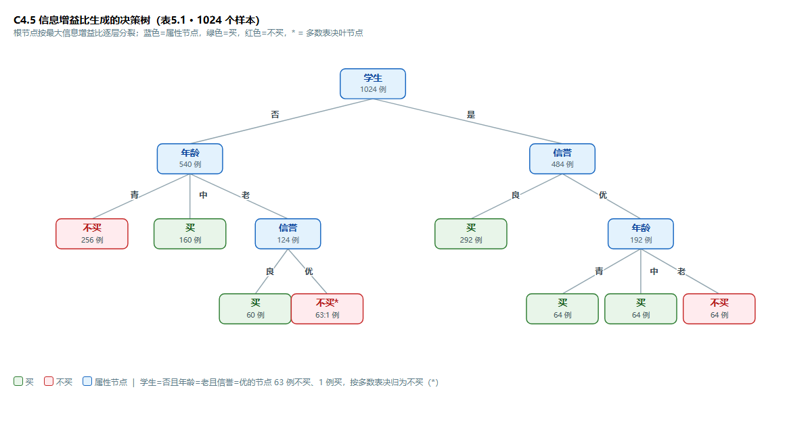

# week4 作业

## 习题 5.1　

### 题目与数据
根据表 5.1 所给的训练数据集，利用信息增益比（C4.5 算法）生成决策树。

数据集如下：

| 序号 | 计数  | 年龄 | 收入 | 学生 | 信誉 | 归类：买计算机？ |
| -- | --- | -- | -- | -- | -- | -------- |
| 1  | 64  | 青  | 高  | 否  | 良  | 不买       |
| 2  | 64  | 青  | 高  | 否  | 优  | 不买       |
| 3  | 128 | 中  | 高  | 否  | 良  | 买        |
| 4  | 60  | 老  | 中  | 否  | 良  | 买        |
| 5  | 64  | 老  | 低  | 是  | 良  | 买        |
| 6  | 64  | 老  | 低  | 是  | 优  | 不买       |
| 7  | 64  | 中  | 低  | 是  | 优  | 买        |
| 8  | 128 | 青  | 中  | 否  | 良  | 不买       |
| 9  | 64  | 青  | 低  | 是  | 良  | 买        |
| 10 | 132 | 老  | 中  | 是  | 良  | 买        |
| 11 | 64  | 青  | 中  | 是  | 优  | 买        |
| 12 | 32  | 中  | 中  | 否  | 优  | 买        |
| 13 | 32  | 中  | 高  | 是  | 良  | 买        |
| 14 | 63  | 老  | 中  | 否  | 优  | 不买       |
| 15 | 1   | 老  | 中  | 否  | 优  | 买        |

合计 **1024** 个样本，其中「买」641 例、「不买」383 例。

### 计算过程

#### 根结点

先计算经验熵：

$$H(D)=-\frac{641}{1024}\log_2\frac{641}{1024}-\frac{383}{1024}\log_2\frac{383}{1024} =
\approx 0.953711 $$

**特征「年龄」**

| 年龄取值 | 样本数 | 买 / 不买    | 子集熵 $H(D_v)$ |
| ---- | --- | --------- | ------------ |
| 青    | 384 | 128 / 256 | 0.918296     |
| 中    | 256 | 256 / 0   | 0            |
| 老    | 384 | 257 / 127 | 0.915670     |

$H(D\mid\text{年龄})=\frac{384}{1024}\times 0.918296+\frac{256}{1024}\times 0+\frac{384}{1024}\times 0.915670\approx 0.687737,$

$g(D,\text{年龄})=0.953711-0.687737=0.265974,\qquad H_{\text{年龄}}(D)\approx 1.561278,
\qquad g_R=\frac{0.265974}{1.561278}\approx 0.170357.$

**特征「收入」**

| 收入取值 | 样本数 | 买 / 不买    | 子集熵 $H(D_v)$ |
| ---- | --- | --------- | ------------ |
| 高    | 288 | 160 / 128 | 0.991076     |
| 中    | 480 | 289 / 191 | 0.969719     |
| 低    | 256 | 192 / 64  | 0.811278     |

$H(D\mid\text{收入})=\frac{288}{1024}\times 0.991076+\frac{480}{1024}\times 0.969719+\frac{256}{1024}\times 0.811278\approx 0.936115,$

$g(D,\text{收入})=0.953711-0.936115=0.017596,\qquad H_{\text{收入}}(D)\approx 1.527104,
\qquad g_R=\frac{0.017596}{1.527104}\approx 0.011522.$

**特征「学生」**

| 学生取值 | 样本数 | 买 / 不买    | 子集熵 $H(D_v)$ |
| ---- | --- | --------- | ------------ |
| 是    | 484 | 420 / 64  | 0.563526     |
| 否    | 540 | 221 / 319 | 0.976110     |

$H(D\mid\text{学生})=\frac{484}{1024}\times 0.563526+\frac{540}{1024}\times 0.976110\approx 0.781100,$

$g(D,\text{学生})=0.953711-0.781100=0.172612,\qquad H_{\text{学生}}(D)\approx 0.997842,
\qquad g_R=\frac{0.172612}{0.997842}\approx 0.172985.$

**特征「信誉」**：

| 信誉取值 | 样本数 | 买 / 不买    | 子集熵 $H(D_v)$ |
| ---- | --- | --------- | ------------ |
| 良    | 672 | 480 / 192 | 0.863121     |
| 优    | 352 | 161 / 191 | 0.994754     |

$H(D\mid\text{信誉})=\frac{672}{1024}\times 0.863121+\frac{352}{1024}\times 0.994754\approx 0.908370,$

$g(D,\text{信誉})=0.953711-0.908370=0.045342,\qquad H_{\text{信誉}}(D)\approx 0.928362,
\qquad g_R=\frac{0.045342}{0.928362}\approx 0.048841.$

四个特征的信息增益比汇总：


| 特征 $A$ | 条件熵 $H(D\mid A)$ | 信息增益 $g$ | 固有值 $H_A(D)$ | 增益比 $g_R$    |
| ------ | ---------------- | -------- | ------------ | ------------ |
| 年龄     | 0.687737         | 0.265974 | 1.561278     | 0.170357     |
| 收入     | 0.936115         | 0.017596 | 1.527104     | 0.011522     |
| **学生** | 0.781100         | 0.172612 | 0.997842     | **0.172985** |
| 信誉     | 0.908370         | 0.045342 | 0.928362     | 0.048841     |

「学生」的增益比最大，**根结点取「学生」**，按「是」「否」分为两个分支。


#### 分支「学生 = 否」

$H(D)=-\frac{221}{540}\log_2\frac{221}{540}-\frac{319}{540}\log_2\frac{319}{540}\approx 0.976110.$

候选特征：年龄、收入、信誉

**特征「年龄」**

| 年龄取值 | 样本数 | 买 / 不买  | 子集熵 $H(D_v)$ |
| ---- | --- | ------- | ------------ |
| 青    | 256 | 0 / 256 | 0            |
| 中    | 160 | 160 / 0 | 0            |
| 老    | 124 | 61 / 63 | 0.999812     |

$H(D\mid\text{年龄})=\frac{124}{540}\times 0.999812\approx 0.229587,\qquad g=0.976110-0.229587=0.746523,$

$H_{\text{年龄}}(D)\approx 1.517873,\qquad g_R=\frac{0.746523}{1.517873}\approx 0.491822.$

**特征「收入」**

| 收入取值 | 样本数 | 买 / 不买    | 子集熵 $H(D_v)$ |
| ---- | --- | --------- | ------------ |
| 高    | 256 | 128 / 128 | 1.000000     |
| 中    | 284 | 93 / 191  | 0.912315     |

$H(D\mid\text{收入})=\frac{256}{540}\times 1+\frac{284}{540}\times 0.912315\approx 0.953884,$

$g=0.976110-0.953884=0.022226,\qquad H_{\text{收入}}(D)\approx 0.998060,
\qquad g_R=\frac{0.022226}{0.998060}\approx 0.022269.$

**特征「信誉」**

| 信誉取值 | 样本数 | 买 / 不买    | 子集熵 $H(D_v)$ |
| ---- | --- | --------- | ------------ |
| 良    | 380 | 188 / 192 | 0.999920     |
| 优    | 160 | 33 / 127  | 0.734253     |

$H(D\mid\text{信誉})=\frac{380}{540}\times 0.999920+\frac{160}{540}\times 0.734253\approx 0.921204,$

$g=0.976110-0.921204=0.054906,\qquad H_{\text{信誉}}(D)\approx 0.876716,
\qquad g_R=\frac{0.054906}{0.876716}\approx 0.062627.$

增益比汇总：年龄 **0.491822**、收入 0.022269、信誉 0.062627，取「年龄」为分裂属性：


* 年龄 = 青（256 例，全为不买）→ 叶结点：不买；

* 年龄 = 中（160 例，全为买）→ 叶结点：买；

* 年龄 = 老（124 例，类别不纯）→ 继续分裂。

#### 结点「学生 = 否，年龄 = 老」

$H(D)=-\frac{61}{124}\log_2\frac{61}{124}-\frac{63}{124}\log_2\frac{63}{124}\approx 0.999812.$

候选特征：收入、信誉（年龄已被父结点使用；且该结点中「收入」取值恒为「中」——124 例全部为收入 = 中 —— 其 $H_A(D)=0$、$g=0$，无法作为分裂特征）。

**特征「信誉」**：

| 信誉取值 | 样本数 | 买 / 不买 | 子集熵 $H(D_v)$ |
| ---- | --- | ------ | ------------ |
| 良    | 60  | 60 / 0 | 0            |
| 优    | 64  | 1 / 63 | 0.116115     |

$H(D\mid\text{信誉})=\frac{64}{124}\times 0.116115\approx 0.059930,
\qquad g=0.999812-0.059930=0.939882,$

$H_{\text{信誉}}(D)=-\Big(\frac{60}{124}\log_2\frac{60}{124}+\frac{64}{124}\log_2\frac{64}{124}\Big)\approx 0.999249,
\qquad g_R=\frac{0.939882}{0.999249}\approx 0.940588.$

取「信誉」为分裂属性：


* 信誉 = 良（60 例，全为买）→ 叶结点：买；

* 信誉 = 优（64 例：不买 63、买 1），无其他可再分特征，按多数表决 → 叶结点：不买。

#### 3. 分支「学生 = 是」

$H(D)=-\frac{420}{484}\log_2\frac{420}{484}-\frac{64}{484}\log_2\frac{64}{484}\approx 0.563526.$

候选特征：年龄、收入、信誉。

**特征「年龄」**：

| 年龄取值 | 样本数 | 买 / 不买   | 子集熵 $H(D_v)$ |
| ---- | --- | -------- | ------------ |
| 青    | 128 | 128 / 0  | 0            |
| 中    | 96  | 96 / 0   | 0            |
| 老    | 260 | 196 / 64 | 0.805125     |

$H(D\mid\text{年龄})=\frac{260}{484}\times 0.805125\approx 0.432505,\qquad g=0.563526-0.432505=0.131021,$

$H_{\text{年龄}}(D)\approx 1.451979,\qquad g_R=\frac{0.131021}{1.451979}\approx 0.090236.$

**特征「收入」**

| 收入取值 | 样本数 | 买 / 不买   | 子集熵 $H(D_v)$ |
| ---- | --- | -------- | ------------ |
| 高    | 32  | 32 / 0   | 0            |
| 中    | 196 | 196 / 0  | 0            |
| 低    | 256 | 192 / 64 | 0.811278     |

$H(D\mid\text{收入})=\frac{256}{484}\times 0.811278\approx 0.429106,\qquad g=0.563526-0.429106=0.134420,$

$H_{\text{收入}}(D)\approx 1.273237,\qquad g_R=\frac{0.134420}{1.273237}\approx 0.105574.$

**特征「信誉」**

| 信誉取值 | 样本数 | 买 / 不买   | 子集熵 $H(D_v)$ |
| ---- | --- | -------- | ------------ |
| 良    | 292 | 292 / 0  | 0            |
| 优    | 192 | 128 / 64 | 0.918296     |

$H(D\mid\text{信誉})=\frac{192}{484}\times 0.918296\approx 0.364283,\qquad g=0.563526-0.364283=0.199244,$

$H_{\text{信誉}}(D)\approx 0.968984,\qquad g_R=\frac{0.199244}{0.968984}\approx 0.205621.$

增益比汇总：年龄 0.090236、收入 0.105574、信誉 0.205621，取「信誉」为分裂属性：


* 信誉 = 良（292 例，全为买）→ 叶结点：**买**；

* 信誉 = 优（192 例，类别不纯）→ 继续分裂。

**结点「学生 = 是，信誉 = 优」（192 例，买 128 / 不买 64）**

$H(D)=-\frac{128}{192}\log_2\frac{128}{192}-\frac{64}{192}\log_2\frac{64}{192}\approx 0.918296.$

候选特征：年龄、收入。

**特征「年龄」**：青（64 例，全买）、中（64 例，全买）、老（64 例，全不买），子集熵均为 0。


| 年龄取值 | 样本数 | 买 / 不买 | 子集熵 $H(D_v)$ |
| ---- | --- | ------ | ------------ |
| 青    | 64  | 64 / 0 | 0            |
| 中    | 64  | 64 / 0 | 0            |
| 老    | 64  | 0 / 64 | 0            |

$H(D\mid\text{年龄})=0,\qquad g=0.918296-0=0.918296,$

$H_{\text{年龄}}(D)=-\Big(3\times\frac{64}{192}\log_2\frac{64}{192}\Big)=\log_2 3\approx 1.584963,
\qquad g_R=\frac{0.918296}{1.584963}\approx 0.579380.$

**特征「收入」**：中（64 例，全买）、低（128 例，买 64 / 不买 64），子集熵分别为 0、1。


| 收入取值 | 样本数 | 买 / 不买  | 子集熵 $H(D_v)$ |
| ---- | --- | ------- | ------------ |
| 中    | 64  | 64 / 0  | 0            |
| 低    | 128 | 64 / 64 | 1.000000     |

$H(D\mid\text{收入})=\frac{128}{192}\times 1\approx 0.666667,\qquad g=0.918296-0.666667=0.251629,$

$H_{\text{收入}}(D)\approx 0.918296,\qquad g_R=\frac{0.251629}{0.918296}\approx 0.274018.$

「年龄」的增益比更大（0.579380 > 0.274018），取「年龄」为分裂属性：


* 年龄 = 青（64 例，全为买）→ 叶结点：买；

* 年龄 = 中（64 例，全为买）→ 叶结点：买；

* 年龄 = 老（64 例，全为不买）→ 叶结点：不买。

至此所有分支均到达叶结点，决策树生成完毕。

### 生成的决策树




**树结构**：


```
                   学生 (1024)
        ┌──────────────┴──────────────┐
      否 (540)                        是 (484)
       │ 年龄                          │ 信誉
   ┌───┼────┐                    ┌────┴────┐
  青   中   老                   良         优
  不买  买   信誉               买(292)     年龄
 (256) (160) ┌──┴──┐                  ┌──┬──┴──┐
            良    优                 青  中    老
            买    不买*              买  买    不买
           (60)  (63:1)            (64)(64)  (64)
```

**决策规则**：

```
学生 = 是 ?
├─ 信誉 = 良 ───────────────► 买
└─ 信誉 = 优
   ├─ 年龄 = 青 ────────────► 买
   ├─ 年龄 = 中 ────────────► 买
   └─ 年龄 = 老 ────────────► 不买
学生 = 否 ?
├─ 年龄 = 青 ───────────────► 不买
├─ 年龄 = 中 ───────────────► 买
└─ 年龄 = 老
   ├─ 信誉 = 良 ────────────► 买
   └─ 信誉 = 优 ────────────► 不买（63:1 多数表决）
```

## 5.2

### 题目与数据集
用平方误差损失准则生成二叉回归树（4 个叶节点）
 
| $x_i$ | 1    | 2    | 3    | 4    | 5    | 6    | 7    | 8    | 9    | 10   |
| ----- | ---- | ---- | ---- | ---- | ---- | ---- | ---- | ---- | ---- | ---- |
| $y_i$ | 4.50 | 4.75 | 4.91 | 5.34 | 5.80 | 7.05 | 7.90 | 8.23 | 8.70 | 9.00 |

### 解答

**第一次切分（根节点）**

对 $k = 1, 2, \dots, 9$（$s = (x_k + x_{k+1})/2$）计算总平方误差，找到最小值：


| 切分点 $s$ | 左区域均值 $c_1$ | 右区域均值 $c_2$ | 总 SSE                     |
| ------- | ----------- | ----------- | ------------------------- |
| 1.5     | 4.500       | 6.853       | 22.648                    |
| 2.5     | 4.625       | 7.116       | 17.702                    |
| 3.5     | 4.720       | 7.431       | 12.194                    |
| 4.5     | 4.875       | 7.780       | 7.379                     |
| 5.5     | 5.060       | 8.176       | **3.359 ← 最小**             |
| 6.5     | 5.392       | 8.458       | 5.074                     |
| 7.5     | 5.750       | 8.643       | 10.053                    |
| 8.5     | 6.060       | 8.850       | 15.178                    |
| 9.5     | 6.353       | 9.000       | 21.328                    |

（根结点（不分）的 SSE 为 $27.632$，切分后降至 $3.359$。）

**最优切分：$s = 5.5$（即 $x=5$ 与 $x=6$ 之间）**，即


* $R_1 = \{x \mid x \le 5\}$，$c_1 = \dfrac{4.50 + 4.75 + 4.91 + 5.34 + 5.80}{5} = 5.06$

* $R_2 = \{x \mid x \ge 6\}$，$c_2 = \dfrac{7.05 + 7.90 + 8.23 + 8.70 + 9.00}{5} = 8.176$

**第二次切分**：在 $R_1$ 和 $R_2$ 中选增益更大者


* **SSE** $= (4.50-5.06)^2 + \cdots + (5.80-5.06)^2 = 1.0582$
  *  最优切分 $s = 3.5$：切分后 SSE $= 0.1912$
  *  增益=1.0582-0.1912=0.867

* **SSE** $= (7.05-8.176)^2 + \cdots + (9.00-8.176)^2 = 2.3005$
  * 最优切分 $s = 7.5$：切分后 SSE $= 0.6625$
  * 增益=2.3005-0.6625=1.638

$R_2$ 的增益更大，故切分 $R_2$：

* $R_{21} = \{x \mid 6 \le x \le 7\}$，$c_{21} = \dfrac{7.05 + 7.90}{2} = 7.475$

* $R_{22} = \{x \mid x \ge 8\}$，$c_{22} = \dfrac{8.23 + 8.70 + 9.00}{3} = 8.643$

当前叶节点：$R_1,\ R_{21},\ R_{22}$（共 3 个）。

**第三次切分**：再分裂一个叶节点（达到 4 个）

$R_{21}$ 只有 2 个样本，无法再切。比较 $R_1$ 与 $R_{22}$：

* $R_1$ 切分增益 $= 0.867$

* $R_{22}$ 的 SSE $= 0.3013$，最优切分 $s = 8.5$ 后增益 $= 0.256$

切分 $R_1$（$s = 3.5$）：

* $R_{11} = \{x \mid x \le 3\}$，$c_{11} = \dfrac{4.50 + 4.75 + 4.91}{3} = 4.72$

* $R_{12} = \{x \mid 4 \le x \le 5\}$，$c_{12} = \dfrac{5.34 + 5.80}{2} = 5.57$

**最终回归树**

```
                  ┌── x ≤ 3.5 ──→ R11, c = 4.72
        x ≤ 5.5 ──┤
        │         └── x > 3.5 ──→ R12, c = 5.57
根节点 ──┤
        │                   ┌── x ≤ 7.5 ──→ R21, c = 7.475
        └── x > 5.5 ────────┤
                            └── x > 7.5 ──→ R22, c = 8.643
```

**回归方程：**

$f(x) =
\begin{cases}
4.72, & x \le 3 \\
5.57, & 4 \le x \le 5 \\
7.475, & 6 \le x \le 7 \\
8.643, & x \ge 8
\end{cases}$

各叶结点的平方误差：

| 叶结点 | 样本 | $c$ | 平方误差 |
| --- | --- | --- | --- |
| $R_{11}$ | $x=1,2,3$ | 4.72 | $(4.50-4.72)^2+(4.75-4.72)^2+(4.91-4.72)^2 = 0.0854$ |
| $R_{12}$ | $x=4,5$ | 5.57 | $(5.34-5.57)^2+(5.80-5.57)^2 = 0.1058$ |
| $R_{21}$ | $x=6,7$ | 7.475 | $(7.05-7.475)^2+(7.90-7.475)^2 = 0.3613$ |
| $R_{22}$ | $x=8,9,10$ | 8.643 | $(8.23-8.643)^2+(8.70-8.643)^2+(9.00-8.643)^2 = 0.3013$ |

总平方误差 $= 0.0854 + 0.1058 + 0.3613 + 0.3013 \approx 0.854$。