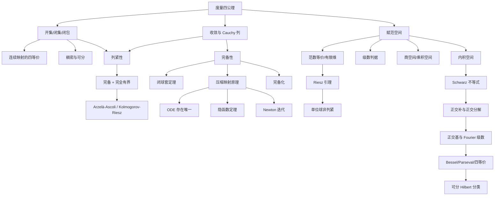

# 泛函分析 · 下：赋范空间与 Hilbert 空间

## 2. 赋范线性空间

### 2.1 范数、诱导距离与 Banach 空间

**定义 2.1（范数）** 设 $X$ 为 $\mathbb K$ 上的线性空间，$\|\cdot\|:X\to\mathbb R$ 满足

1. $\|x\|\ge0$；
2. $\|x\|=0\iff x=0$；
3. $\|\alpha x\|=|\alpha|\|x\|$；
4. $\|x+y\|\le\|x\|+\|y\|$。

则称 $\|\cdot\|$ 为范数，$(X,\|\cdot\|)$ 为赋范线性空间。完备的赋范空间称为 Banach 空间。

**命题 2.2** 设 $X$ 为赋范空间，$d(x,y)=\|x-y\|$。则 $d$ 为度量；且

(i) $d$ 平移不变、正齐次；

(ii) $\big|\|x\|-\|y\|\big|\le\|x-y\|$，故 $\|\cdot\|$ 连续；

(iii) 线性运算连续：$x_n\to x$、$y_n\to y$、$\alpha_n\to\alpha$ 蕴含 $\alpha_nx_n+y_n\to\alpha x+y$。

*证明*：(i) 由范数定义。(ii) 命题 0.6。(iii) 由
$$\|\alpha_nx_n+y_n-\alpha x-y\|\le|\alpha_n|\|x_n-x\|+|\alpha_n-\alpha|\|x\|+\|y_n-y\| . \qquad\square$$

**命题 2.3（范数/距离的判别）** 线性空间上的距离 $d$ 由某范数诱导，当且仅当 $d$ 平移不变且正齐次；此时 $\|x\|=d(x,0)$。

*证明*：见命题 1.4。$\square$

> 注：$B(X)$、$l^\infty$、$C[a,b]$ 上的上确界距离由范数诱导；例 1.2 第 6、7 项的度量不满足正齐次性，故不是。

### 2.2 标准空间及其完备性、可分性

**定理 2.4（$C[a,b]$ 在两种范数下）**

(i) $\left(C[a,b],\|\cdot\|_\infty\right)$ 为 Banach 空间，且可分。

(ii) $\left(C[a,b],\|\cdot\|_1\right)$（$\|x\|_1=\int_a^b|x|$）为赋范空间但不完备，且可分。

*证明*：(i) 完备性见例 1.50；可分性由 Weierstrass 定理与有理系数多项式可数得到。(ii) 不完备性见例 1.50 的反例；可分性因 $\|\cdot\|_1\le(b-a)\|\cdot\|_\infty$，故 $\sup$ 范数下的稠密集在 $L^1$ 范数下仍稠密。$\square$

**定理 2.5（$L^p$ 空间，$1\le p<\infty$）** $L^p(E)$ 为 Banach 空间，且可分。

*证明*：完备性即 Riesz–Fischer 定理（引用）；范数公理中仅三角不等式需要命题 0.4。可分性：$C_c^\infty$ 稠密（定理 1.28），而具有理系数与有理端点的紧支光滑函数全体可数。$\square$

**定理 2.6（$L^\infty$）** $L^\infty(E)$ 为 Banach 空间，但当 $m(E)>0$ 时不可分。

*证明*：完备性与 $l^\infty$ 相同（逐点取极限、一致本性上确界估计）。不可分性见定理 1.26。$\square$

**定理 2.7（$l^p$ 与 $l^\infty$）**

(i) $l^p$（$1\le p<\infty$）为可分 Banach 空间。

(ii) $l^\infty$ 为不可分 Banach 空间。

(iii) $c$ 与 $c_0$ 为 $l^\infty$ 的闭子空间，从而为可分 Banach 空间。

*证明*：(i)(ii) 见定理 1.26 与例 1.50。(iii) $c_0\subset c\subset l^\infty$ 显然为子空间。设 $x^{(n)}\in c$，$x^{(n)}\to x$ 于 $l^\infty$。给定 $\varepsilon>0$，取 $n$ 使 $\|x^{(n)}-x\|_\infty<\varepsilon/3$；因 $x^{(n)}$ 收敛，存在 $K$ 使 $k,l>K$ 时 $|\xi^{(n)}_k-\xi^{(n)}_l|<\varepsilon/3$，于是
$$|\xi_k-\xi_l|\le|\xi_k-\xi^{(n)}_k|+|\xi^{(n)}_k-\xi^{(n)}_l|+|\xi^{(n)}_l-\xi_l|<\varepsilon,$$
故 $x\in c$，即 $c$ 闭。对 $c_0$ 类似（另需 $\lim_k\xi_k=0$：取 $n$ 后令 $k\to\infty$）。可分的稠密集取有限个有理坐标、其余为零的数列。$\square$

**定理 2.8（$C_b$ 与 $C_0$）** $C_b(\mathbb R)$ 为不可分 Banach 空间；$C_0(\mathbb R)$ 为可分 Banach 空间。

*证明*：$C_b$ 完备性同 $l^\infty$；不可分性见定理 1.26。$C_0$：对 $f\in C_0$ 与 $\varepsilon>0$，取 $R$ 使 $|f|<\varepsilon$ 于 $|t|\ge R$，再用 $[-R,R]$ 上有理系数多项式逼近并零延拓，得可数稠密集；完备性因其为 $C_b$ 的闭子空间（一致收敛保持 $\lim_{|t|\to\infty}f=0$）。$\square$

**命题 2.9（$L^p$ 的包含关系）** 设 $m(E)<\infty$，$1\le\beta<p\le\infty$。则
$$L^\infty(E)\subset L^p(E)\subset L^\beta(E),$$
且包含映射连续。

*证明*：设 $f\in L^\infty$，$\|f\|_\infty=M$，则 $\int|f|^p\le M^pm(E)<\infty$。设 $f\in L^p$，令 $B=\{|f|\le1\}$，则
$$\int_E|f|^\beta=\int_B|f|^\beta+\int_{E\setminus B}|f|^\beta\le m(B)+\int_{E\setminus B}|f|^p<\infty . \qquad\square$$

**命题 2.10（收敛的强弱，$m(E)<\infty$）**
$$L^\infty\Rightarrow L^p\Rightarrow L^\beta\Rightarrow\text{依测度},\qquad \|f\|_\infty=\lim_{p\to\infty}\|f\|_p .$$
*证明*：前两个由命题 2.9 及 $\|f\|_\beta^\beta\le\|f\|_p^\beta m(E)^{1-\beta/p}$（Hölder）。$L^p\Rightarrow$ 依测度由 Chebyshev 不等式。最后一式由
$$\|f\|_p\le\|f\|_\infty m(E)^{1/p},\qquad \|f\|_p\ge\|f\|_\infty-\varepsilon\ \text{于正测度集上}. \qquad\square$$

> 注：依测度收敛不蕴含 $L^p$ 收敛（无控制收敛）；$L^p$ 收敛不蕴含 a.e. 收敛（可沿子列）。

### 2.3 凸性、子空间与 Riesz 引理

**定义 2.11（凸集、凸包）** $A\subset X$ 为凸集，若 $\alpha x+(1-\alpha)y\in A$ 对一切 $x,y\in A$、$\alpha\in[0,1]$ 成立。含 $A$ 的最小凸集称为凸包，记 $\operatorname{co}(A)$。

**命题 2.12** 开单位球 $B(0,1)$ 与闭单位球 $\overline B(0,1)$ 均为凸集。

*证明*：$\|\alpha x+(1-\alpha)y\|\le\alpha\|x\|+(1-\alpha)\|y\|<1$（或 $\le1$）。$\square$

**命题 2.13（真开子空间不存在）** 设 $X_1$ 为赋范空间 $X$ 的线性子空间。若 $X_1$ 为开集，则 $X_1=X$。

*证明*：$0\in X_1$ 为内点，故存在 $r>0$ 使 $B(0,r)\subset X_1$。任取 $x\ne0$，令 $\lambda=r/(2\|x\|)$，则 $\|\lambda x\|=r/2<r$，故 $\lambda x\in X_1$，由数乘封闭得 $x=\lambda^{-1}(\lambda x)\in X_1$。$\square$

**命题 2.14（子空间的闭包）** 设 $M$ 为 $X$ 的线性子空间，则 $\overline M$ 为闭线性子空间。

*证明*：取 $x,y\in\overline M$，$\alpha\in\mathbb K$，取 $x_n,y_n\in M$ 使 $x_n\to x$、$y_n\to y$。由线性运算连续，$x_n+\alpha y_n\to x+\alpha y$，故 $x+\alpha y\in\overline M$。又 $\overline{\overline M}=\overline M$。$\square$

**例 2.15（不闭的子空间）**

(i) $P[a,b]\subset C[a,b]$ 为子空间但不闭（$e^t\in\overline P\setminus P$）。

(ii) $Y=\{\{x_n\}\in l^\infty:\exists N,\ x_n=0\ \forall n>N\}$ 为子空间但不闭：$y^{(n)}=(1,\frac12,\dots,\frac1n,0,\dots)\to(1,\frac12,\dots)\notin Y$。

(iii) $C$（收敛数列全体）为 $l^\infty$ 的闭子空间（定理 2.7(iii)）。

**定理 2.16（Riesz 引理）** 设 $X_0\subsetneq X$ 为赋范空间 $X$ 的真闭子空间。则对任意 $\varepsilon\in(0,1)$，存在 $x_0\in X$ 使 $\|x_0\|=1$ 且
$$\operatorname{dist}(x_0,X_0):=\inf_{x\in X_0}\|x_0-x\|>1-\varepsilon .$$

*证明*：取 $x_1\in X\setminus X_0$，令 $d=\operatorname{dist}(x_1,X_0)$。由 $X_0$ 闭得 $d>0$（否则存在 $x_n\in X_0$ 使 $\|x_1-x_n\|\to0$，则 $x_1\in X_0$）。取 $x_2\in X_0$ 使
$$\|x_1-x_2\|<\frac{d}{1-\varepsilon}.$$
令 $x_0=\dfrac{x_1-x_2}{\|x_1-x_2\|}$，则 $\|x_0\|=1$。对任意 $x\in X_0$，由 $x_2+\|x_1-x_2\|x\in X_0$，
$$\|x-x_0\|=\frac{\|(x_1-x_2)+\|x_1-x_2\|(-x)\|}{\|x_1-x_2\|}\ge\frac{d}{\|x_1-x_2\|}>1-\varepsilon . \qquad\square$$

**推论 2.17** 设 $X$ 为无穷维赋范空间，则闭单位球 $\overline B(0,1)$ 不列紧；从而 $X$ 中有界闭集不必列紧。

*证明*：取 $x_1$ 为单位向量，归纳地：设 $X_{n}=\operatorname{span}\{x_1,\dots,x_n\}$ 为真闭子空间（无穷维），由 Riesz 引理取 $x_{n+1}$ 使 $\|x_{n+1}\|=1$、$\operatorname{dist}(x_{n+1},X_n)>1/2$。则 $i\ne j$ 时 $\|x_i-x_j\|>1/2$，无收敛子列。$\square$

**推论 2.18（有限维的判别）** 赋范空间 $X$ 有限维当且仅当 $\overline B(0,1)$ 列紧，当且仅当 $X$ 中任意有界集列紧。

*证明*：有限维情形见推论 2.22；无穷维情形由推论 2.17。$\square$

### 2.4 有限维赋范空间

**定义 2.19（等价范数）** 设 $\|\cdot\|_1,\|\cdot\|_2$ 为 $X$ 上的两个范数。若存在 $a,b>0$ 使
$$a\|\cdot\|_1\le\|\cdot\|_2\le b\|\cdot\|_1,$$
则称二者等价。

**命题 2.20** 等价范数诱导等价的距离，从而有相同的收敛列、Cauchy 列与完备性；反之，两个范数若诱导相同的收敛性，则等价。

*证明*：前半由定理 1.23。后半：若不等价，不妨不存在 $b$ 使 $\|\cdot\|_2\le b\|\cdot\|_1$，则存在 $x_n\ne0$ 使 $\|x_n\|_2>n\|x_n\|_1$。令 $y_n=x_n/\|x_n\|_2$，则 $\|y_n\|_2=1$ 而 $\|y_n\|_1<1/n\to0$，故 $y_n\to0$ 于 $\|\cdot\|_1$ 而不于 $\|\cdot\|_2$，矛盾。$\square$

**定理 2.21（有限维范数等价）** 设 $X$ 为 $n$ 维赋范空间，则 $X$ 上任意两个范数等价；更确切地，$X$ 与 $\mathbb K^n$ 代数同构且拓扑同胚。

*证明*：取基 $e_1,\dots,e_n$，$x=\sum\xi_ke_k$，令 $\|x\|_2^*=\left(\sum|\xi_k|^2\right)^{1/2}$（$\mathbb K^n$ 的欧氏范数）。由 Cauchy 不等式，
$$\|x\|\le\sum|\xi_k|\|e_k\|\le\beta\|x\|_2^*,\qquad \beta=\Big(\sum\|e_k\|^2\Big)^{1/2}.$$
令 $S=\{\xi:\|\xi\|_2^*=1\}$（$\mathbb K^n$ 中紧集），$f(\xi)=\left\|\sum\xi_ke_k\right\|$。由
$$|f(\xi)-f(\eta)|\le\|x-y\|\le\beta\|\xi-\eta\|_2^*$$
知 $f$ 连续且处处为正，故 $\alpha=\min_Sf>0$。对 $x\ne0$，
$$\|x\|=\|\xi\|_2^*f(\xi/\|\xi\|_2^*)\ge\alpha\|\xi\|_2^*,$$
即 $\alpha\|x\|_2^*\le\|x\|\le\beta\|x\|_2^*$。故任意范数都与 $\|\cdot\|_2^*$ 等价。$\square$

**推论 2.22** 有限维赋范空间完备；其上的有界闭集列紧（Bolzano–Weierstrass）；有限维子空间必闭。

*证明*：完备性与列紧性由定理 2.21 归结到 $\mathbb K^n$。若 $M$ 为有限维子空间，取 $M$ 中收敛列 $x_n\to x\in X$，则 $\{x_n\}$ 在 $M$ 中为 Cauchy 列，由 $M$ 完备得其在 $M$ 中收敛，极限必为 $x$，故 $x\in M$。$\square$

**定理 2.23（有限维逼近的其他等价形式）** 对赋范空间 $X$，下列命题等价：

(i) $\dim X<\infty$；

(ii) $X$ 中任意有界集相对列紧；

(iii) $X$ 局部列紧（存在列紧的邻域）。

*证明*：(i)$\Rightarrow$(ii) 推论 2.22；(ii)$\Rightarrow$(iii) 显然；(iii)$\Rightarrow$(i) 若 $\dim X=\infty$，由推论 2.17，单位球不列紧，任何邻域含单位球的平移，故不列紧。$\square$

### 2.5 级数、商空间与乘积空间

**定理 2.24（级数判据）** 设 $X$ 为赋范空间。则 $X$ 完备当且仅当
$$\sum_{n=1}^\infty\|x_n\|<\infty\ \Longrightarrow\ \sum_{n=1}^\infty x_n\ \text{收敛}.$$

*证明*：设 $X$ 完备且 $\sum\|x_n\|<\infty$。令 $S_n=\sum_{k=1}^nx_k$，则对 $p\ge1$，
$$\|S_{n+p}-S_n\|\le\sum_{k=n+1}^{n+p}\|x_k\|\to0\qquad(n\to\infty),$$
故 $\{S_n\}$ 为 Cauchy 列，收敛；且 $\left\|\sum x_n\right\|\le\sum\|x_n\|$。

反之设条件成立。任取 Cauchy 列 $\{y_n\}$，取子列使 $\|y_{n_{k+1}}-y_{n_k}\|<2^{-k}$。则 $\sum_k\|y_{n_{k+1}}-y_{n_k}\|<\infty$，故 $\sum_k(y_{n_{k+1}}-y_{n_k})$ 收敛，即 $\{y_{n_k}\}$ 收敛。由命题 1.45(iii)，$\{y_n\}$ 收敛。$\square$

**定义 2.25（商空间）** 设 $M$ 为 $X$ 的线性子空间。在 $X/M=\{x+M:x\in X\}$ 上定义
$$\tilde x+\tilde y=\widetilde{x+y},\qquad \alpha\tilde x=\widetilde{\alpha x},$$
若 $M$ 闭，定义商范数
$$\|\tilde x\|_{X/M}=\inf_{y\in\tilde x}\|y\|=d(x,M).$$

**命题 2.26** 若 $M$ 为 $X$ 的闭子空间，则 $\|\cdot\|_{X/M}$ 为 $X/M$ 上的范数；若 $X$ 完备，则 $X/M$ 完备。

*证明*：范数公理：正定性用 $M$ 闭（若 $\|\tilde x\|=0$，存在 $y_n\in\tilde x$ 使 $\|y_n\|\to0$，故 $0\in\overline{\tilde x}=\tilde x$，即 $x\in M$）；齐次性与三角不等式由下确界性质。完备性：设 $\{\tilde x_n\}$ 为 Cauchy 列，取子列使 $\|\tilde x_{n_{k+1}}-\tilde x_{n_k}\|<2^{-k}$。由商范数定义取 $u_k\in\tilde x_{n_k}$、$z_k\in M$ 使
$$\|u_{k+1}-u_k+z_k\|<2^{-k},$$
则 $\sum_k\|u_{k+1}-u_k+z_k\|<\infty$，由 $X$ 完备得级数 $\sum_k(u_{k+1}-u_k+z_k)$ 收敛，记其和为 $v$，令 $u=v+u_1$。由 $\sum_{j\le k}z_j\in M$ 及
$$\|\tilde u_{k+1}-\tilde u\|\le\Big\|u_{k+1}-v-u_1-\sum_{j\le k}z_j\Big\|=\Big\|\sum_{j\le k}(u_{j+1}-u_j+z_j)-v\Big\|\to0,$$
得子列收敛；Cauchy 列有收敛子列则整列收敛。$\square$

> 注：$M$ 不闭时 $\|\cdot\|_{X/M}$ 只是半范数（可能有 $\|\tilde x\|=0$ 而 $\tilde x\ne\{0\}$）。

**定义 2.27（乘积空间）** 设 $(X_i,\|\cdot\|_i)$（$i=1,\dots,n$）为赋范空间，$X=\prod_{i=1}^nX_i$，定义
$$\|(x_1,\dots,x_n)\|_p=\Big(\sum_{i=1}^n\|x_i\|_i^p\Big)^{1/p}\ (1\le p<\infty),\qquad \|(x_1,\dots,x_n)\|_\infty=\max_i\|x_i\|_i .$$

**命题 2.28** 上述 $\|\cdot\|_p$ 均为范数且两两等价；$X$ 完备当且仅当每个 $X_i$ 完备。

*证明*：范数公理由各因子的范数公理与命题 0.4；等价性由有限维空间的范数等价性（定理 2.21）作用于 $(\|x_1\|,\dots,\|x_n\|)\in\mathbb R^n$。完备性：逐坐标取极限后组合即可。$\square$

---

## 3. 内积空间与 Hilbert 空间

### 3.1 内积、Schwarz 不等式与极化恒等式

**定义 3.1（内积空间）** 设 $H$ 为 $\mathbb K$ 上的线性空间，$\langle\cdot,\cdot\rangle:H\times H\to\mathbb K$ 满足

1. $\langle x,x\rangle\ge0$，且 $\langle x,x\rangle=0\iff x=0$；
2. $\langle x,y\rangle=\overline{\langle y,x\rangle}$；
3. $\langle\alpha x+\beta y,z\rangle=\alpha\langle x,z\rangle+\beta\langle y,z\rangle$。

则称 $\langle\cdot,\cdot\rangle$ 为内积。

**命题 3.2（Schwarz 不等式）** 对任意 $x,y\in H$，
$$|\langle x,y\rangle|^2\le\langle x,x\rangle\langle y,y\rangle,$$
等号成立当且仅当 $x,y$ 线性相关。

*证明*：若 $y=0$ 显然。设 $y\ne0$，对任意 $\lambda\in\mathbb K$，
$$0\le\langle x+\lambda y,x+\lambda y\rangle=\langle x,x\rangle+\overline\lambda\langle x,y\rangle+\lambda\langle y,x\rangle+|\lambda|^2\langle y,y\rangle .$$
取 $\lambda=-\dfrac{\langle x,y\rangle}{\langle y,y\rangle}$，得
$$0\le\langle x,x\rangle-\frac{|\langle x,y\rangle|^2}{\langle y,y\rangle},$$
即得。等号成立当且仅当 $x+\lambda y=0$。$\square$

**命题 3.3** $\|x\|=\sqrt{\langle x,x\rangle}$ 为 $H$ 上的范数。

*证明*：前三条显然；三角不等式由
$$\|x+y\|^2=\|x\|^2+2\operatorname{Re}\langle x,y\rangle+\|y\|^2\le\|x\|^2+2\|x\|\|y\|+\|y\|^2=(\|x\|+\|y\|)^2 . \qquad\square$$

**命题 3.4（内积的连续性）** 若 $x_n\to x$、$y_n\to y$，则 $\langle x_n,y_n\rangle\to\langle x,y\rangle$。

*证明*：由 Schwarz 不等式，
$$|\langle x_n,y_n\rangle-\langle x,y\rangle|\le\|x_n\|\|y_n-y\|+\|x_n-x\|\|y\| . \qquad\square$$

**命题 3.5（稠密性判据）** 设 $M\subset H$ 稠密，$x_0\in H$，且 $\langle x_0,x\rangle=0$ 对一切 $x\in M$ 成立，则 $x_0=0$。

*证明*：取 $x_n\in M$，$x_n\to x_0$。由连续性 $\langle x_0,x_0\rangle=\lim_n\langle x_0,x_n\rangle=0$。$\square$

**命题 3.6（平行四边形法则与极化恒等式）** 对任意 $x,y\in H$，

(i) $\|x+y\|^2+\|x-y\|^2=2(\|x\|^2+\|y\|^2)$；

(ii) $\langle x,y\rangle=\dfrac14\Big(\|x+y\|^2-\|x-y\|^2+i\|x+iy\|^2-i\|x-iy\|^2\Big)$。

*证明*：展开
$$\|x\pm y\|^2=\|x\|^2\pm2\operatorname{Re}\langle x,y\rangle+\|y\|^2,\qquad
\|x\pm iy\|^2=\|x\|^2\pm2\operatorname{Im}\langle x,y\rangle+\|y\|^2,$$
(i) 由两式相加，(ii) 由第 1、2 式相减加 $i$ 倍第 3、4 式相减。$\square$

**定理 3.7（Jordan–von Neumann）** 设 $X$ 为赋泛空间，若其范数满足平行四边形法则，则存在 $X$ 上的内积使 $\|x\|^2=\langle x,x\rangle$。

*证明（要点）*：由 (ii) 定义 $\langle x,y\rangle$，逐一验证内积公理；平行四边形法则用于证明可加性
$$\langle x+y,z\rangle=\langle x,z\rangle+\langle y,z\rangle .$$
（此步为标准的代数验证，此处引用。）$\square$

**定义 3.8（Hilbert 空间）** 完备的内积空间称为 Hilbert 空间。

**命题 3.9** 设 $H$ 为 Hilbert 空间，$Y\subset H$ 为线性子空间。则 $Y$ 为 Hilbert 空间当且仅当 $Y$ 为闭子空间。

*证明*：$Y$ Hilbert $\iff$ $Y$ 中 Cauchy 列在 $Y$ 中收敛 $\iff$ $Y$ 闭（因 $H$ 完备）。$\square$

**例 3.10** $\mathbb R^n,\mathbb C^n$（标准内积）、$L^2(E)$（$\langle f,g\rangle=\int_Ef\bar g$）、$l^2$ 均为 Hilbert 空间；$C[a,b]$ 配 $\langle f,g\rangle=\int_a^bf\bar g$ 不是 Hilbert 空间（不完备，例 1.50）。

---

### 3.2 正交、正交补与正交分解

**定义 3.11** 设 $M,N\subset H$。

- $x\perp y$：$\langle x,y\rangle=0$；$x\perp M$：对一切 $y\in M$，$\langle x,y\rangle=0$。
- $M\perp N$：对一切 $x\in M$、$y\in N$，$\langle x,y\rangle=0$。
- $M^\perp=\{y\in H:\langle x,y\rangle=0,\ \forall x\in M\}$，称为 $M$ 的正交补。

**命题 3.12（勾股定理）** 若 $x\perp y$，则 $\|x+y\|^2=\|x\|^2+\|y\|^2$；更一般地，若 $x_1,\dots,x_n$ 两两正交，则
$$\Big\|\sum_{k=1}^nx_k\Big\|^2=\sum_{k=1}^n\|x_k\|^2 .$$
*证明*：展开内积，交叉项为零。$\square$

**命题 3.13（正交补的性质）** 设 $M,N\subset H$，则

(i) $0\in M^\perp$；若 $0\in M$，则 $M\cap M^\perp=\{0\}$；

(ii) $\{0\}^\perp=H$，$H^\perp=\{0\}$；

(iii) 若 $N\subset M$，则 $M^\perp\subset N^\perp$；$M\subset(M^\perp)^\perp$；

(iv) $M^\perp$ 为闭线性子空间；

(v) 若 $M$ 含某个开球，则 $M^\perp=\{0\}$。

*证明*：(i) $\langle 0,y\rangle=0$；若 $x\in M\cap M^\perp$，则 $\langle x,x\rangle=0$，故 $x=0$。(ii) 显然；若 $x\in H^\perp$，则 $\langle x,x\rangle=0$。(iii) 直接由定义。(iv) 线性性由内积对第一变量的线性；闭性由命题 3.4：若 $x_n\in M^\perp$、$x_n\to x$，则 $\langle x,y\rangle=\lim\langle x_n,y\rangle=0$。(v) 设 $B(a,r)\subset M$，$x\in M^\perp$。对任意 $z\ne0$，取 $h=\dfrac{r}{2\|z\|}z$，则 $a+h\in B(a,r)\subset M$，故 $\langle x,a+h\rangle=0$，又 $\langle x,a\rangle=0$，得 $\langle x,h\rangle=0$，即 $\langle x,z\rangle=0$。故 $x\perp H$，$x=0$。$\square$

**命题 3.14（正交补的距离刻画）** 设 $M$ 为 $H$ 的线性子空间，则
$$x\in M^\perp\iff\|x-y\|\ge\|x\|,\quad\forall y\in M .$$
*证明*：若 $x\in M^\perp$，则 $\|x-y\|^2=\|x\|^2+\|y\|^2\ge\|x\|^2$。反之，对任意 $y\in M$、$\alpha\in\mathbb K$，由 $\alpha y\in M$ 得
$$\|x\|^2\le\|x-\alpha y\|^2=\|x\|^2-2\operatorname{Re}\big(\bar\alpha\langle x,y\rangle\big)+|\alpha|^2\|y\|^2 .$$
取 $\alpha=t\bar{\langle x,y\rangle}$（$t>0$）并令 $t\to0^+$，得 $|\langle x,y\rangle|^2\le0$，故 $\langle x,y\rangle=0$。$\square$

**定义 3.15（严格凸）** 赋范空间 $X$ 严格凸，若 $\|x\|=\|y\|=1$、$x\ne y$ 时，对一切 $0<\lambda<1$ 有 $\|\lambda x+(1-\lambda)y\|<1$。

**命题 3.16** 内积空间严格凸。

*证明*：设 $\|x\|=\|y\|=1$，$x\ne y$，$0<\lambda<1$。若 $x,y$ 线性相关，则 $x=\omega y$，$|\omega|=1$，$\omega\ne1$，故
$$\|\lambda x+(1-\lambda)y\|=|\lambda\omega+1-\lambda|=|1-\lambda(1-\omega)|<1 .$$
若线性无关，由 Schwarz 不等式严格不等号得 $\operatorname{Re}\langle x,y\rangle<1$，于是
$$\|\lambda x+(1-\lambda)y\|^2=\lambda^2+2\lambda(1-\lambda)\operatorname{Re}\langle x,y\rangle+(1-\lambda)^2<1 . \qquad\square$$

**定理 3.17（最佳逼近）** 设 $H$ 为 Hilbert 空间，$M\subset H$ 为非空闭凸集。则对每个 $x\in H$，存在唯一的 $x_0\in M$ 使
$$\|x-x_0\|=d(x,M)=\inf_{y\in M}\|x-y\| .$$

*证明*：取极小化序列 $y_n\in M$ 使 $\|x-y_n\|\to d$。由平行四边形法则，
$$\|y_n-y_m\|^2=2\|x-y_n\|^2+2\|x-y_m\|^2-4\Big\|x-\frac{y_n+y_m}{2}\Big\|^2\le2\|x-y_n\|^2+2\|x-y_m\|^2-4d^2\to0,$$
其中用了 $\dfrac{y_n+y_m}{2}\in M$。故 $\{y_n\}$ 为 Cauchy 列，由 $H$ 完备及 $M$ 闭得 $y_n\to x_0\in M$，且 $\|x-x_0\|=d$。唯一性：若 $x_0,x_1$ 均为最近点，同上式得 $\|x_0-x_1\|^2\le2d^2+2d^2-4d^2=0$。$\square$

**定理 3.18（正交分解）** 设 $H$ 为 Hilbert 空间，$M$ 为 $H$ 的闭子空间。则
$$H=M\oplus M^\perp,$$
即每个 $x\in H$ 可唯一地写成 $x=x_0+y$，$x_0\in M$，$y\in M^\perp$；且
$$\|x\|^2=\|x_0\|^2+\|y\|^2 .$$

*证明*：由定理 3.17（$M$ 闭凸），取 $x_0\in M$ 为 $x$ 在 $M$ 上的最佳逼近点，令 $y=x-x_0$。对任意 $z\in M$，
$$\|y-z\|=\|x-(x_0+z)\|\ge\|x-x_0\|=\|y\|,$$
由命题 3.14 得 $y\in M^\perp$。唯一性：若 $x=x_0+y=x_0'+y'$，则 $x_0-x_0'=y'-y\in M\cap M^\perp=\{0\}$。勾股定理由 $x_0\perp y$。$\square$

**推论 3.19** 设 $M$ 为 Hilbert 空间 $H$ 的闭子空间，则 $(M^\perp)^\perp=M$。

*证明*：$M\subset(M^\perp)^\perp$ 由命题 3.13(iii)。反之取 $x\in(M^\perp)^\perp$，作分解 $x=x_0+y$，$x_0\in M$，$y\in M^\perp$。则
$$0=\langle x,y\rangle=\langle x_0,y\rangle+\langle y,y\rangle=\|y\|^2,$$
故 $y=0$，$x=x_0\in M$。$\square$

> 注：$M$ 不闭时只能得 $(M^\perp)^\perp=\overline M$。

---

### 3.3 正交系、Fourier 系数与正交基

**定义 3.20** 设 $\{e_\alpha\}_{\alpha\in I}\subset H$。

- 若 $\alpha\ne\beta$ 时 $\langle e_\alpha,e_\beta\rangle=0$，称为**正交系**；若再有 $\|e_\alpha\|=1$，称为**标准正交系**。
- 若 $\overline{\operatorname{span}}\{e_\alpha\}=H$，称为 $H$ 的**正交基**（标准正交基）。
- 对标准正交系，$\hat x(\alpha)=\langle x,e_\alpha\rangle$ 称为 Fourier 系数，形式级数 $\sum_\alpha\langle x,e_\alpha\rangle e_\alpha$ 称为 Fourier 级数。

**命题 3.21** 正交系线性无关；若 $\dim H=n<\infty$ 且 $\{e_1,\dots,e_n\}$ 为标准正交系，则它是 $H$ 的基，且对每个 $x\in H$，
$$x=\sum_{k=1}^n\langle x,e_k\rangle e_k .$$
*证明*：若 $\sum\alpha_ke_k=0$，对 $e_m$ 作内积得 $\alpha_m=0$。维数论证给出它是基；两边对 $e_m$ 作内积得系数。$\square$

**定理 3.22（投影的最佳逼近性质）** 设 $\{e_1,\dots,e_n\}$ 为标准正交系，$x\in H$，则对任意 $a_1,\dots,a_n\in\mathbb K$，
$$\Big\|x-\sum_{k=1}^n\langle x,e_k\rangle e_k\Big\|\le\Big\|x-\sum_{k=1}^na_ke_k\Big\|,$$
等号成立当且仅当 $a_k=\langle x,e_k\rangle$（$k=1,\dots,n$）。

*证明*：令 $P x=\sum\langle x,e_k\rangle e_k$，则 $x-Px\perp e_j$（$j=1,\dots,n$），故 $x-Px\perp\sum(a_k-\langle x,e_k\rangle)e_k$。由勾股定理，
$$\Big\|x-\sum a_ke_k\Big\|^2=\|x-Px\|^2+\sum_{k=1}^n|a_k-\langle x,e_k\rangle|^2\ge\|x-Px\|^2 . \qquad\square$$

**推论 3.23** $\Big\|x-\sum_{k=1}^n\langle x,e_k\rangle e_k\Big\|^2=\|x\|^2-\sum_{k=1}^n|\langle x,e_k\rangle|^2$。

**例 3.24** $L^2[-\pi,\pi]$ 中三角系
$$\Big\{\frac1{\sqrt{2\pi}},\ \frac{\cos kt}{\sqrt\pi},\ \frac{\sin kt}{\sqrt\pi}\ (k\ge1)\Big\}$$
为标准正交基；$L^2[0,2\pi]$ 中 $\left\{\dfrac{e^{int}}{\sqrt{2\pi}}\right\}_{n\in\mathbb Z}$ 为标准正交基；$L^2([0,2\pi]^2)$ 中 $\{e^{i(mx+ny)}\}_{m,n\in\mathbb Z}$ 为标准正交基。

*证明（第三个）*：正交性由变量分离的积分直接计算。完全性：设 $\langle f,e^{i(mx+ny)}\rangle=0$ 对一切 $m,n$ 成立。令
$$F_m(y)=\int_0^{2\pi}f(x,y)e^{-imx}\,dx .$$
则 $\int_0^{2\pi}F_m(y)e^{-iny}dy=0$ 对一切 $n$ 成立，由 $\{e^{iny}\}$ 在 $L^2[0,2\pi]$ 中的完全性得 $F_m=0$ a.e.，即 $f(\cdot,y)\perp e^{imx}$ 对一切 $m$ 成立；再用 $\{e^{imx}\}$ 的完全性得 $f(\cdot,y)=0$ a.e.。由 Fubini 定理 $f=0$ a.e.。$\square$

---

### 3.4 Bessel 不等式、Parseval 等式与完全性的等价刻画

**定理 3.25（Bessel 不等式）** 设 $\{e_k\}_{k=1}^\infty$ 为标准正交列，则对每个 $x\in H$，
$$\sum_{k=1}^\infty|\langle x,e_k\rangle|^2\le\|x\|^2 .$$

*证明*：由推论 3.23，部分和 $\sum_{k=1}^n|\langle x,e_k\rangle|^2=\|x\|^2-\|x-\sum_{k=1}^n\langle x,e_k\rangle e_k\|^2\le\|x\|^2$，令 $n\to\infty$。$\square$

**推论 3.26** $\langle x,e_k\rangle\to0$（$k\to\infty$）。特别地（Riemann–Lebesgue），对 $f\in L^2[-\pi,\pi]$，
$$\lim_{n\to\infty}\int_{-\pi}^\pi f(t)\cos nt\,dt=\lim_{n\to\infty}\int_{-\pi}^\pi f(t)\sin nt\,dt=0 .$$

**推论 3.27** 对每个 $x$，至多可数个 Fourier 系数非零。

*证明*：由 $\sum|\langle x,e_\alpha\rangle|^2<\infty$，对每个 $n$ 只有有限个 $|\langle x,e_\alpha\rangle|>1/n$。$\square$

**定理 3.28（正交级数的收敛判据）** 设 $H$ 为 Hilbert 空间，$\{e_n\}$ 为标准正交列，$\{\alpha_n\}\subset\mathbb K$。则
$$\sum_{n=1}^\infty\alpha_ne_n\ \text{收敛}\iff\sum_{n=1}^\infty|\alpha_n|^2<\infty,$$
且此时 $\Big\|\sum\alpha_ne_n\Big\|^2=\sum|\alpha_n|^2$。

*证明*：若级数收敛于 $x$，则由内积连续性 $\alpha_m=\langle x,e_m\rangle$，由 Bessel 不等式得 $\sum|\alpha_n|^2\le\|x\|^2$。反之，令 $S_k=\sum_{n=1}^k\alpha_ne_n$，则对 $k>j$，
$$\|S_k-S_j\|^2=\sum_{n=j+1}^k|\alpha_n|^2\to0,$$
故 $\{S_k\}$ 为 Cauchy 列，收敛；范数等式由勾股定理与极限。$\square$

**推论 3.29** 对任意 $x\in H$，Fourier 级数 $\sum_n\langle x,e_n\rangle e_n$ 收敛。

**定义 3.30（Parseval 等式与完全性）** 称 $\{e_n\}$ 关于 $x$ 满足 Parseval 等式，若
$$\|x\|^2=\sum_{n=1}^\infty|\langle x,e_n\rangle|^2 .$$
若对每个 $x\in H$ 成立，称 $\{e_n\}$ 完备。

**定理 3.31（完全性的四等价）** 设 $\{e_n\}_{n=1}^\infty$ 为 Hilbert 空间 $H$ 中的标准正交列。则下列命题等价：

(i) $\{e_n\}^\perp=\{0\}$（完全）；

(ii) 对每个 $x\in H$，$x=\sum_{n=1}^\infty\langle x,e_n\rangle e_n$；

(iii) $\overline{\operatorname{span}}\{e_n\}=H$（是正交基）；

(iv) 对每个 $x\in H$，Parseval 等式成立。

*证明*：

(i)$\Rightarrow$(ii)：令 $y=x-\sum_n\langle x,e_n\rangle e_n$。由内积连续性，对每个 $m$，
$$\langle y,e_m\rangle=\langle x,e_m\rangle-\langle x,e_m\rangle=0,$$
故 $y\in\{e_n\}^\perp=\{0\}$。

(ii)$\Rightarrow$(iii)：由 (ii)，每个 $x$ 属于 $\overline{\operatorname{span}}\{e_n\}$。

(iii)$\Rightarrow$(i)：设 $y\in\{e_n\}^\perp$。则 $\operatorname{span}\{e_n\}\subset\{y\}^\perp$，而 $\{y\}^\perp$ 为闭子空间（命题 3.13(iv)），故 $H=\overline{\operatorname{span}}\{e_n\}\subset\{y\}^\perp$，即 $y\perp H$，$y=0$。

(ii)$\Rightarrow$(iv)：由范数连续性与勾股定理，
$$\|x\|^2=\lim_{n\to\infty}\Big\|\sum_{k=1}^n\langle x,e_k\rangle e_k\Big\|^2=\sum_{k=1}^\infty|\langle x,e_k\rangle|^2 .$$

(iv)$\Rightarrow$(i)：若 $x\in\{e_n\}^\perp$，则所有 Fourier 系数为 $0$，由 (iv) 得 $\|x\|=0$。$\square$

> 注：上述证明中 (i)$\Rightarrow$(ii) 用到级数 $\sum\langle x,e_n\rangle e_n$ 在 $H$ 中收敛（完备性），从而 $y=x-\sum\langle x,e_n\rangle e_n$ 仍是 $H$ 的元素。在非完备内积空间中该推理不适用，四条命题需分别讨论。

**推论 3.32** 三角系为 $L^2[-\pi,\pi]$ 的标准正交基（由 Weierstrass 三角多项式逼近定理与定理 3.31(iii)）。

---

### 3.5 Gram–Schmidt 正交化与可分 Hilbert 空间的分类

**定理 3.33（Gram–Schmidt）** 设 $\{x_n\}$ 为内积空间 $H$ 中的可数子集。则存在标准正交列 $\{e_n\}$ 使
$$\operatorname{span}\{e_1,\dots,e_k\}=\operatorname{span}\{x_1,\dots,x_k\},\qquad\forall k .$$

*证明*：令 $x_{n_1}$ 为第一个非零元，$e_1=x_{n_1}/\|x_{n_1}\|$。设 $e_1,\dots,e_{k-1}$ 已构造，取 $x_{n_k}$ 为第一个不属于 $\operatorname{span}\{e_1,\dots,e_{k-1}\}$ 的元素，令
$$h_k=x_{n_k}-\sum_{i=1}^{k-1}\langle x_{n_k},e_i\rangle e_i,\qquad e_k=\frac{h_k}{\|h_k\|}.$$
则 $h_k\ne0$ 且 $h_k\perp e_i$（$i<k$）。张成空间相同由构造直接得到。$\square$

**例 3.34（Legendre 多项式）** 在 $L^2[-1,1]$ 中对 $1,t,t^2,\dots$ 作 Gram–Schmidt，得
$$e_n=\sqrt{n+\tfrac12}\,P_n(t),\qquad P_n(t)=\frac1{2^nn!}\frac{d^n}{dt^n}\big[(t^2-1)^n\big].$$
由于多项式在 $L^2[-1,1]$ 中稠密，$\{e_n\}$ 为标准正交基。

**定理 3.35（可分 Hilbert 空间的分类）** 设 $H$ 为 Hilbert 空间。则 $H$ 可分当且仅当 $H$ 有至多可数的标准正交基。若基含 $N$ 个元素，则 $H$ 等距同构于 $\mathbb K^N$（$N<\infty$）或 $l^2$（$N=\infty$）。

*证明*：设 $H$ 可分，取可数稠密集 $\{x_n\}$，删去可由前面元素线性表出的元素得线性无关子集 $\{y_n\}$，仍稠密。由 Gram–Schmidt 得标准正交列 $\{e_n\}$，且 $\overline{\operatorname{span}}\{e_n\}=\overline{\operatorname{span}}\{x_n\}=H$，故 $\{e_n\}$ 为正交基。

反之设 $\{e_n\}_{n=1}^\infty$ 为标准正交基。令
$$A=\Big\{\sum_{n=1}^k\alpha_ne_n:\ \operatorname{Re}\alpha_n,\operatorname{Im}\alpha_n\in\mathbb Q,\ k\in\mathbb N\Big\},$$
$A$ 可数。对 $y=\sum\beta_ne_n$ 与 $\varepsilon>0$，取 $k$ 使 $\sum_{n>k}|\beta_n|^2<\varepsilon^2/2$，再取有理数 $\alpha_n$ 使 $|\beta_n-\alpha_n|^2<\varepsilon^2/(2k)$，则
$$\|y-x\|^2=\sum_{n\le k}|\beta_n-\alpha_n|^2+\sum_{n>k}|\beta_n|^2<\varepsilon^2 .$$
故 $H$ 可分。等距同构由 $x\mapsto(\langle x,e_n\rangle)_n$ 给出，它是满射（由定理 3.28）且保范（由 Parseval 等式）。$\square$

---

## 4. 跨章汇总

### 4.1 判据总表

| 待判定性质 | 充要条件 |
| --- | --- |
| $A$ 闭 | $\overline A=A$ $\iff$ $A$ 中收敛列极限在 $A$ 内 $\iff$ $d(x,A)=0\Rightarrow x\in A$ |
| $B$ 在 $A$ 中稠密 | $\overline B\supset A$ $\iff$ $\forall x\in A,\forall\varepsilon,\exists y\in B,\ d(x,y)<\varepsilon$ |
| $X$ 可分 | 存在可数稠密集 $\iff$ 存在可数集使 $\forall x,\forall\varepsilon,\exists k,\ d(x_k,x)<\varepsilon$ |
| $X$ 完备 | 每个 Cauchy 列收敛 $\iff$（赋范）$\sum\|x_n\|<\infty\Rightarrow\sum x_n$ 收敛；完备的必要条件是半径趋于 $0$ 的闭球套交非空且为单点（对递减非空闭集套，该条件亦充分） |
| $A$ 相对列紧 | $\overline A$ 列紧 $\iff$（$X$ 完备）$A$ 完全有界 |
| $A$ 完全有界 | $\forall\varepsilon>0$ 有有限 $\varepsilon$-网 $\iff$ 有界且 $\forall\varepsilon$ 可用有限维子空间 $\varepsilon$-逼近 |
| $A\subset C[a,b]$ 相对列紧 | 一致有界 + 等度连续（Arzelà–Ascoli） |
| $A\subset L^p(\mathbb R)$ 相对列紧 | 有界 + 一致消失于无穷 + 平移等度连续（Kolmogorov–Riesz） |
| $A\subset C_0(\mathbb R)$ 相对列紧 | 有界 + 等度连续 + 一致消失于无穷 |
| $T:X\to X$ 有唯一不动点 | $X$ 完备且 $T$ 为压缩（$\theta<1$）；或某 $T^{n_0}$ 为压缩 |
| $\{e_n\}$ 为正交基 | $\{e_n\}^\perp=\{0\}$ $\iff$ $x=\sum\langle x,e_n\rangle e_n$ $\iff$ $\overline{\operatorname{span}}=H$ $\iff$ Parseval |
| $H$ 可分 | 有至多可数标准正交基 $\iff$ $H\cong\mathbb K^N$ 或 $l^2$ |
| $M$ 闭子空间且 $X$ 完备 | $X/M$ 完备（商范数） |

### 4.2 反例总表

1. **有界闭但非列紧**：无穷维赋范空间的闭单位球；取近似正交列 $e_n$，$i\ne j$ 时 $\|e_i-e_j\|>1/2$。

2. **完备但非列紧**：$\mathbb R$ 中序列 $\{n\}$ 无收敛子列。

3. **相对列紧但非列紧**：$(0,1)\subset\mathbb R$；$\overline{(0,1)}=[0,1]$ 紧，但 $(0,1)$ 不闭，序列 $\{1/n\}$ 在 $(0,1)$ 中无收敛于 $(0,1)$ 内点的子列。

4. **Cauchy 列不收敛**：$\mathbb Q$ 中收敛到 $\sqrt2$ 的数列；$C[0,1]$ 配 $L^1$ 范数时的台阶函数列。

5. **伪度量而非度量**：$0<p<1$ 时 $(L^p[0,1],d)$，$d(f,g)=\int|f-g|^p$；需商去 a.e. 相等。

6. **非范数诱导的距离**：$\sum_k2^{-k}\dfrac{|\xi_k-\eta_k|}{1+|\xi_k-\eta_k|}$；$d'=\dfrac d{1+d}$；$d''=\ln(1+d)$。

7. **同一空间不同范数、完备性不同**：$C[0,1]$ 配 $\sup$（完备）与配 $\int|f|$（不完备）。

8. **不闭的子空间**：$P[a,b]\subset C[a,b]$；有限支撑列 $\subset l^\infty$；$C_c^\infty\subset L^p$。

9. **无限多个开集之交不必开**：$\bigcap_{n=1}^\infty\left(-\frac1n,\frac1n\right)=\{0\}$ 在 $\mathbb R$ 中。

10. **两个闭集距离为 $0$ 但不能分离**：$E=\{0\}$，$F=\{1/n\}$，$\mathbb R$ 中。

11. **可分性依赖度量**：$\mathbb R^{\mathbb N}$ 配乘积度量可分，配 $l^\infty$ 度量不可分。

12. **内积空间但不完备**：$C[0,1]$ 配 $\langle f,g\rangle=\int f\bar g$；$P[0,1]$ 配同内积。

13. **非 Hilbert 的 $L^p$**：$p\ne2$ 时 $L^p$ 的范数不满足平行四边形法则，故不来自内积。

14. **正交系但不是正交基**：$\mathbb R^2$ 中 $\{(1,0)\}$；$L^2[-\pi,\pi]$ 中除去 $\sin t$ 后的三角系。

15. **同一线性空间上不同范数不等价**：$C[0,1]$ 上 $\|\cdot\|_\infty$ 与 $\|\cdot\|_1$；只有 $\|x\|_1\le\|x\|_\infty$ 一边成立。

16. **非严格压缩但有唯一不动点**：$\mathbb R^n$ 的有界闭集上满足 $d(\varphi x,\varphi y)<d(x,y)$ 的映射（命题 1.55）；去掉闭性后 $(0,1]$ 上 $\varphi(x)=x/2$ 无不动点。

17. **压缩条件只在开球内成立时唯一性可失效（无连续性）**：命题 1.54 注中的分段映射 $T$，$0$ 与 $1$ 均为不动点。

18. **不可分的 $C_b$**：$\{e^{i\alpha t}:\alpha\in\mathbb R\}$ 两两距离为 $2$。

19. **闭球套半径不趋于零则交为空**：$\mathbb R$ 中 $\overline S_n=[n,\infty)$。

20. **$L^\infty\not\subset L^p$（$m(E)=\infty$）**：$\mathbb R$ 上 $f\equiv1$。

### 4.4 主要定理的依赖关系

